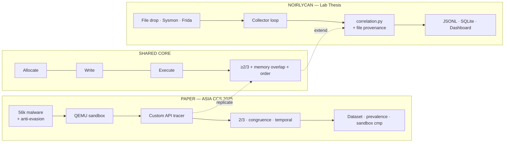
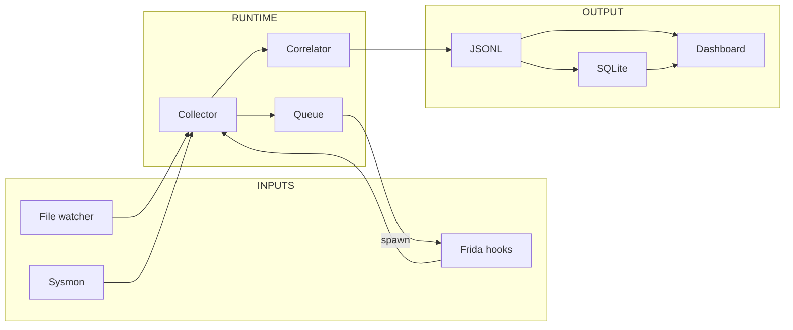

# Noirlycan — Sơ đồ kiến trúc (1 trang · slide bảo vệ)

> **Kích thước khuyến nghị:** FigJam / slide 16:9 (1920×1080 hoặc 1440×810).  
> **Tài liệu đầy đủ:** [`architecture-diagrams.md`](architecture-diagrams.md)  
> **Vẽ Figma không chồng lớp:** [`design/figma-architecture-layout.md`](design/figma-architecture-layout.md) + import [`design/architecture-comparison-template.svg`](design/architecture-comparison-template.svg)

---

## Slide title (gợi ý)

**Noirlycan: Extending ASIA CCS 2025 Process-Injection Detection with File-Provenance Lab Telemetry**

---

## Sơ đồ chính — Paper vs Noirlycan (một khung hình)

Dán diagram dưới đây vào slide hoặc FigJam. Layout ngang: **trái = paper**, **phải = Noirlycan**, **giữa = lõi chung**.



---

## FigJam layout — sticky zones (copy vào FigJam)

Vẽ **3 cột** trên canvas 1440px. Mỗi cột một màu sticky.

```
┌─────────────────────────────────────────────────────────────────────────────────────────┐
│  NOIRLYCAN ARCHITECTURE — Thesis Defense (1 page)                                        │
│  Subtitle: file on disk → process lineage → injection primitives                        │
├──────────────────────┬──────────────────────┬──────────────────────────────────────────┤
│  COL A — PAPER       │  COL B — SHARED CORE │  COL C — NOIRLYCAN EXTENSION             │
│  (gray #E8EAED)      │  (amber #FEF3C7)     │  (cyan #E0F7FA)                          │
├──────────────────────┼──────────────────────┼──────────────────────────────────────────┤
│                      │                      │                                          │
│  [Malware corpus]    │   ┌─ ALLOCATE ─┐     │  ┌─ SENSORS ─────────────────────┐       │
│        ↓             │   │  WRITE    │     │  │ Sysmon (kernel) E1·3·7·8·10·11│       │
│  [QEMU + tracer]     │   │  EXECUTE  │     │  │ Frida (user) 121 API hooks   │       │
│        ↓             │   └─────┬─────┘     │  │ FileDropWatcher              │       │
│  [API trace logs]    │         ↓           │  └──────────────┬───────────────┘       │
│        ↓             │  [2-of-3 rule]      │                 ↓                       │
│  [Batch correlate]   │  [Memory congruence]│  ┌─ COLLECTOR ─────────────────┐       │
│        ↓             │  [Temporal order]   │  │ cli.py · collector_runtime  │       │
│  [12 techniques]     │         ↓           │  │ analysis_queue · triage     │       │
│        ↓             │  injection_api_     │  └──────────────┬───────────────┘       │
│  [56k stats · VT]    │  manifest.py       │                 ↓                       │
│                      │  correlation.py    │  [Correlator + classifier + net watch]  │
│                      │                      │                 ↓                       │
│                      │                      │  [JSONL] → [SQLite] → [Dashboard]     │
│                      │                      │  corpus · reclassify · EN/VI          │
└──────────────────────┴──────────────────────┴──────────────────────────────────────────┘
```

### Màu sticky (FigJam)

| Zone | Màu | Nội dung |
|------|-----|----------|
| Paper | `#E8EAED` | Batch sandbox, 56k mẫu, prevalence |
| Shared | `#FEF3C7` | 3 primitive, 2/3, congruence, temporal |
| Noirlycan | `#E0F7FA` | Sysmon+Frida, file provenance, dashboard |
| Arrow replicate | `#F59E0B` dashed | Paper methodology → `correlation.py` |
| Arrow extend | `#06B6D4` solid | File provenance, dual telemetry |

---

## Pipeline ngang — chỉ Noirlycan (nếu cần slide 2 mini)



---

## 3 bullet đóng góp (đặt dưới sơ đồ)

1. **Replication** — Triển khai lõi 2/3 primitive + memory congruence của Di Pietro et al. trên Frida (`correlation.py`, tests).
2. **Extension** — Pipeline *file provenance*: Sysmon E11 → static triage → process lineage → finding (`related_file`).
3. **Engineering** — Kiến trúc Sysmon ∪ Frida, JSONL session, dashboard tương tác, corpus/reclassify cho lab Windows 10/11.

---

## Speaker notes (30 giây)

> Paper ASIA CCS 2025 trả lời *injection phổ biến thế nào* bằng sandbox batch và custom tracer.  
> Noirlycan không thay thế paper — nó **kế thừa lõi 2-of-3 primitive** và **mở rộng** sang lab Windows thực: quan sát từ lúc file xuất hiện, kết hợp Sysmon kernel và Frida user-mode, xuất session JSONL và dashboard cho thí nghiệm thesis.

---

## Export checklist

- [ ] **Figma (khuyến nghị):** import `architecture-comparison-template.svg` → chỉnh font/màu
- [ ] Hoặc FigJam: 3 section theo [`figma-architecture-layout.md`](design/figma-architecture-layout.md)
- [ ] Slide phụ (optional): pipeline 4 swimlane §2 trong layout guide
- [ ] Chú thích: DOI 10.1145/3708821.3736206 + `NoirlycanThesis` repo
