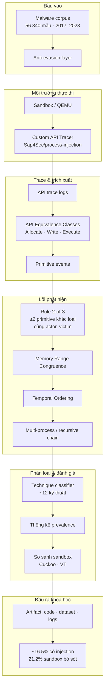
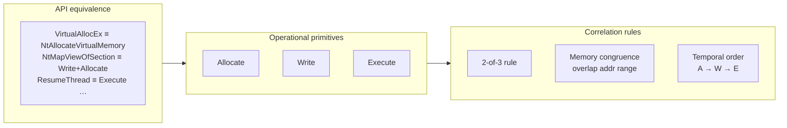
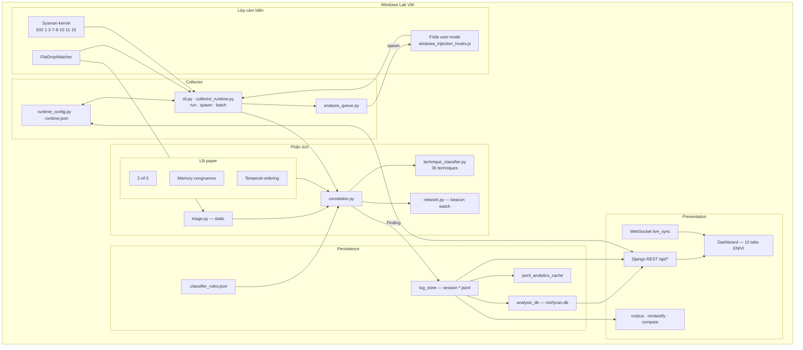
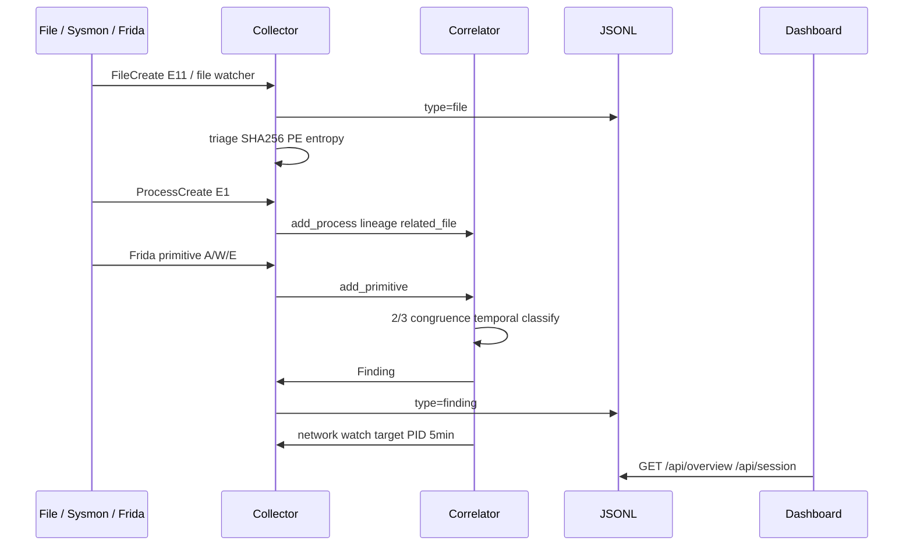
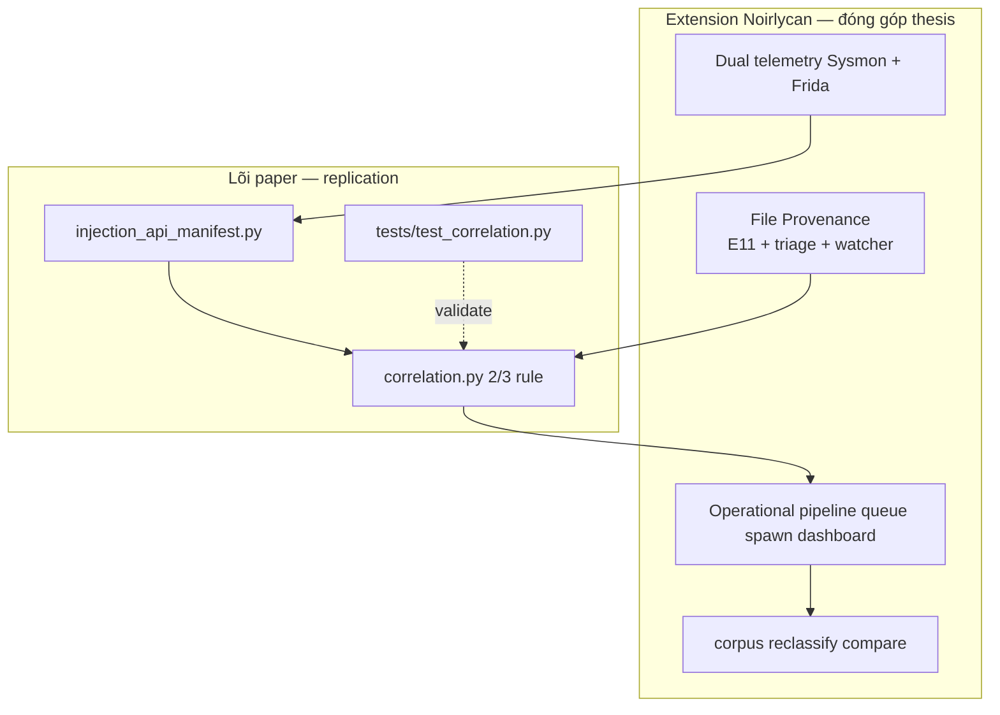
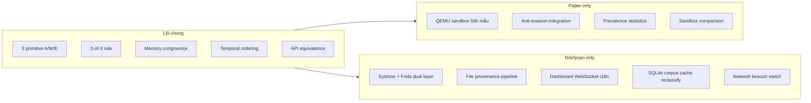

# Sơ đồ kiến trúc — Noirlycan & ASIA CCS 2025

Tài liệu phục vụ **Chương 5 (Phương pháp)** và **Chương 6 (Thiết kế & hiện thực)** của luận văn.  
Phiên bản một trang cho slide bảo vệ: [`architecture-diagrams-slide.md`](architecture-diagrams-slide.md).

**Paper tham chiếu:** Di Pietro, D'Elia, Querzoni — *Can You Run My Code? A Close Look at Process Injection in Windows Malware* (ASIA CCS 2025).  
DOI: [10.1145/3708821.3736206](https://doi.org/10.1145/3708821.3736206)

**Đối chiếu chi tiết:** [`report-asiaccs25-comparison.md`](report-asiaccs25-comparison.md), [`paper-and-repo-analysis.md`](paper-and-repo-analysis.md).

---

## 1. Kiến trúc paper (ASIA CCS 2025)

Paper là **framework phân tích batch quy mô lớn**. Mục tiêu: đo prevalence injection và đề xuất phương pháp phát hiện tổng quát trên sandbox.

### 1.1. Sơ đồ tổng thể

### 1.2. Đặc điểm kiến trúc

| Lớp | Vai trò |
|-----|---------|
| Tracer đơn | Một lớp instrumentation custom trong sandbox QEMU |
| Batch-first | Chạy hàng chục nghìn mẫu; không UI real-time |
| Điểm bắt đầu | Process đã thực thi trong sandbox |
| Đầu ra | Dataset, thống kê prevalence, so sánh sandbox |

### 1.3. Bốn thành tố methodology (paper §3)

---

## 2. Kiến trúc hệ thống Noirlycan (implementation)

Prototype lab Windows 10/11: **kế thừa lõi 2/3 primitive**, mở rộng file provenance, dual telemetry, dashboard.

### 2.1. Sơ đồ phân lớp

### 2.2. Module map (Chương 6)

| Module | Vai trò | Kết nối |
|--------|---------|---------|
| `cli.py` | Entry: run, spawn, dashboard, corpus, reclassify | → collector_runtime, log_store |
| `collector_runtime.py` | Vòng lặp, JsonlWriter, drain Frida/Sysmon | → correlation, sysmon, frida_manager |
| `sysmon.py` | Đọc Event Log Sysmon | → correlator |
| `frida_manager.py` | Attach/spawn, primitive bridge | → correlator |
| `file_watch.py` | Poll thư mục lab | → triage, analysis_queue |
| `correlation.py` | Lõi 2/3 + scoring + network watch | ← paper methodology |
| `injection_api_manifest.py` | PAPER_API_CLASSES | ← paper Appendix |
| `technique_classifier.py` | Rule cascade 36 kỹ thuật | extension |
| `log_store.py` | Đọc/ghi JSONL, aggregate | → dashboard views |
| `analysis_db.py` | SQLite uploads, findings, cache | → dashboard views |
| `session_analytics.py` | Corpus metrics | → /api/corpus |
| `reclassify.py` | Replay JSONL offline | → /api/reclassify |
| `dashboard/` | Django + Daphne :8765 | REST + WebSocket |

### 2.3. Luồng dữ liệu — file-drop loader

### 2.4. JSONL event types

| `type` | Nguồn | Ý nghĩa |
|--------|--------|---------|
| `file` | Sysmon E11/E15, watcher | File mới trên đĩa |
| `sysmon` | Sysmon E1/E7/E8/E10 | Process, image, access |
| `primitive` | Frida | Allocate / write / execute |
| `finding` | Correlator | Injection phát hiện |
| `triage` | triage.py | Static analysis |
| `network` | Sysmon E3 | Kết nối sau injection watch |
| `evasion` | Frida | Anti-analysis signal |
| `frida_raw` | Frida | Raw hook payload |

### 2.5. Storage layers

| Layer | Path | Nội dung |
|-------|------|----------|
| JSONL sessions | `logs/session-*.jsonl` | Telemetry chính, append-only |
| Analysis DB | `logs/noirlycan.db` | uploads, parsed_sessions, stored_findings, cache |
| Runtime | `logs/.runtime.json` | Heartbeat, watch toggles |
| Queue | `logs/.analysis_queue.json` | Spawn requests từ dashboard |
| Classifier | `logs/.classifier_rules.json` | Thresholds, custom rules |

---

## 3. So sánh kiến trúc Paper ↔ Noirlycan

### 3.1. Sơ đồ đặt chồng (overlay)

### 3.2. Bảng đối chiếu

| Khía cạnh | Paper ASIA CCS 2025 | Noirlycan |
|-----------|---------------------|-----------|
| Mục tiêu | Prevalence injection quy mô lớn | Lab: file → process → injection |
| Instrumentation | 1 lớp custom tracer (sandbox) | Frida user + Sysmon kernel |
| Điểm bắt đầu | Process trong sandbox | File trên đĩa (E11 + watcher) |
| Lõi detection | 2/3 + congruence + temporal | **Kế thừa** `correlation.py` |
| API classes | Equivalence classes đầy đủ | **Kế thừa** `injection_api_manifest.py` |
| Phân loại kỹ thuật | ~12 kỹ thuật | 36 enum + rule cascade |
| Static analysis | Không | triage PE/entropy/signature |
| Vận hành | Batch offline | CLI real-time + dashboard |
| Persistence | Dataset nghiên cứu | JSONL + SQLite + cache |
| Hậu injection | Phân tích thủ công | Network beacon watch 5 phút |
| Đánh giá | 56.340 mẫu | PoC loader + subset |
| Đầu ra | Thống kê, artifact | JSONL, findings score, UI |

### 3.3. Mapping methodology → module

| Thành tố paper | Module repo | File |
|----------------|-------------|------|
| 3 operational primitive | `PrimitiveKind` | `models.py` |
| API equivalence class | `PAPER_API_CLASSES` | `injection_api_manifest.py` |
| Quy tắc 2/3 | `operational_kind_count >= 2` | `correlation.py`, `execution_analysis.py` |
| Memory congruence | `_has_memory_congruence()` | `correlation.py` |
| Temporal ordering | `_has_temporal_consistency()` | `correlation.py` |
| File provenance | `add_file`, `created_from_file` | `correlation.py`, `file_watch.py` |
| Technique labeling | `InjectionTechnique` + rules | `technique_classifier.py` |

### 3.4. Chỉ paper / chỉ Noirlycan

---

## 4. Gợi ý chèn vào luận văn

| Chương | Sơ đồ | Mục đích |
|--------|-------|----------|
| **Ch. 5 — Methodology** | §1.3 (4 thành tố paper) | Định nghĩa phương pháp gốc |
| **Ch. 5 — Methodology** | §3.1 (overlay) | Vị trí đóng góp thesis |
| **Ch. 6 — Design** | §2.1 (phân lớp) | Kiến trúc implementation |
| **Ch. 6 — Design** | §2.2 (module map) | Chi tiết module |
| **Ch. 6 — Design** | §2.3 (sequence) | Luồng file-drop loader |
| **Ch. 3 — Related Work** | §3.2 (bảng đối chiếu) | Positioning vs paper |

**Chú thích hình (gợi ý):**  
*Figure X: Architecture of the ASIA CCS 2025 process-injection detection framework (left) and the Noirlycan lab telemetry extension (right). Shared core: 2-of-3 operational primitive rule with memory congruence and temporal ordering.*

---

## 5. Tài liệu liên quan

- [`architecture-diagrams-slide.md`](architecture-diagrams-slide.md) — một trang FigJam cho slide
- [`report-asiaccs25-comparison.md`](report-asiaccs25-comparison.md)
- [`paper-and-repo-analysis.md`](paper-and-repo-analysis.md)
- [`thesis-outline.md`](thesis-outline.md)
- [`design/noirlycan-figma-blueprint.md`](design/noirlycan-figma-blueprint.md)
