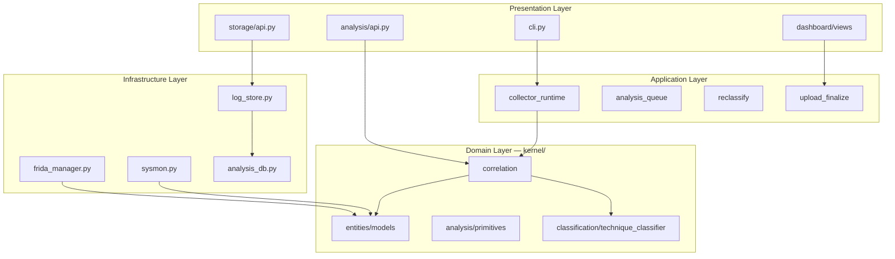
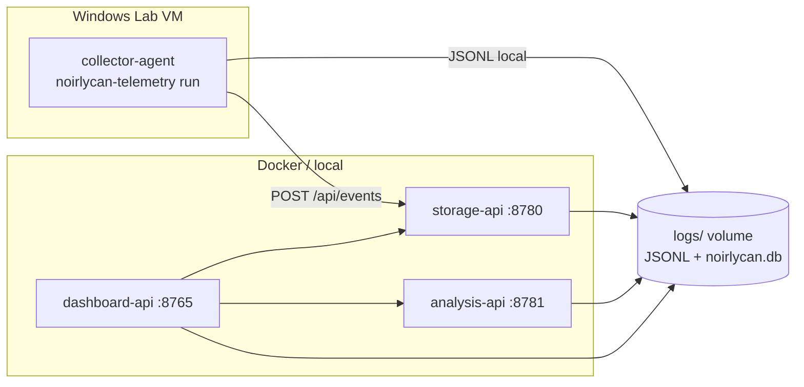

# Clean Architecture & Microservices — Noirlycan Telemetry

Tài liệu mô tả kiến trúc sau khi tái cấu trúc codebase theo **Clean Architecture** (Uncle Bob) và chia thành **4 microservices** để dễ kiểm soát, triển khai và mở rộng.

---

## 1. Tổng quan

| Thành phần | Vai trò | Port mặc định |
|------------|---------|---------------|
| **collector** | Thu thập Sysmon + Frida + file-drop trên Windows VM | 8782 (health) |
| **storage** | Ghi/đọc JSONL, SQLite uploads | 8780 |
| **analysis** | Correlator 2/3, classifier, reclassify | 8781 |
| **dashboard** | Django REST + WebSocket UI | 8765 |

**Shared kernel** (`kernel/`) chứa domain entities và business rules — không phụ thuộc framework hay I/O.

---

## 2. Sơ đồ phân lớp Clean Architecture



**Quy tắc phụ thuộc:** Presentation → Application → Domain ← Infrastructure. Domain không import từ layer ngoài.

---

## 3. Cấu trúc thư mục

```text
src/noirlycan_telemetry/
├── kernel/                          # Domain thuần (shared)
│   ├── entities/models.py           # FileEvent, Finding, MemoryPrimitive…
│   ├── analysis/                    # primitives, payload, evasion, injection_graph
│   └── classification/              # technique_classifier, custom_rule_engine
├── services/
│   ├── collector/
│   │   ├── application/             # collector_runtime, analysis_queue, runtime_config
│   │   ├── infrastructure/        # sysmon, frida_manager, file_watch, triage
│   │   └── api.py                   # GET /health
│   ├── analysis/
│   │   ├── domain/                  # correlation, reclassify, batch_runner
│   │   └── api.py                   # POST /api/reclassify
│   ├── storage/
│   │   ├── infrastructure/          # log_store, analysis_db, atomic_io
│   │   └── api.py                   # GET /api/sessions, POST /api/events
│   └── dashboard/                   # Django app (presentation)
├── contracts/events.py              # TelemetryEnvelope — wire format giữa services
└── cli.py                           # Composition root (monolith mode)
```

---

## 4. Microservices & giao tiếp



### Chế độ triển khai

| Mode | Mô tả | Khi nào dùng |
|------|-------|--------------|
| **Monolith** | `noirlycan-telemetry run` + `dashboard` — in-process | Dev lab, thesis demo |
| **Microservices** | `docker compose up` — 3 container + collector trên VM | Kiểm soát từng service, scale dashboard |

---

## 5. API contracts

### Storage (`:8780`)

| Method | Path | Mô tả |
|--------|------|-------|
| GET | `/health` | Health check |
| GET | `/api/sessions` | Liệt kê session JSONL |
| GET | `/api/session/{name}` | Chi tiết session |
| POST | `/api/events` | Ghi event `{type, value, session?}` |

### Analysis (`:8781`)

| Method | Path | Mô tả |
|--------|------|-------|
| GET | `/health` | Health check |
| POST | `/api/reclassify` | `{session: "session-xxx.jsonl"}` |
| POST | `/api/correlate/ping` | Kiểm tra correlator sẵn sàng |

### Collector health (`:8782`)

| Method | Path | Mô tả |
|--------|------|-------|
| GET | `/health` | Trạng thái `.runtime.json`, heartbeat |

---

## 6. Chạy hệ thống

### Monolith (mặc định)

```powershell
noirlycan-telemetry run --watch-sysmon
noirlycan-telemetry dashboard
```

### Microservices (Docker)

```bash
docker compose up --build
# Dashboard: http://127.0.0.1:8765
# Storage:    http://127.0.0.1:8780/health
# Analysis:   http://127.0.0.1:8781/health
```

Trên Windows VM, collector vẫn chạy native:

```powershell
noirlycan-telemetry run --watch-sysmon
# hoặc health sidecar:
noirlycan-collector-health --port 8782
```

### Chạy từng service riêng lẻ

```bash
noirlycan-storage   --port 8780 --logs-dir ./logs
noirlycan-analysis  --port 8781 --logs-dir ./logs
noirlycan-telemetry dashboard --port 8765 --no-auto-collector
```

---

## 7. Import paths

```python
from noirlycan_telemetry.kernel.entities.models import Finding
from noirlycan_telemetry.services.analysis.domain.correlation import Correlator
from noirlycan_telemetry.services.dashboard import make_client
```

---

## 8. Lộ trình tiếp theo

1. **Event bus** — Redis pub/sub thay vì ghi JSONL trực tiếp giữa collector và storage
2. **gRPC/Protobuf** — thay HTTP JSON cho high-volume primitive stream
3. **Tách dashboard BFF** — API gateway proxy tới storage + analysis
4. **Observability** — structured logging, metrics per service (Prometheus)

---

## 9. Liên hệ với luận văn (Chương 6)

Kiến trúc mới **không thay đổi logic correlator 2/3** — chỉ tổ chức lại module theo boundary rõ ràng:

- **Lõi paper [4]:** `kernel/analysis/primitives.py`, `services/analysis/domain/correlation.py`
- **Extension luận văn:** file provenance, dashboard, classifier — tách service riêng
- **E5 anti-evasion:** vẫn chỉ ghi nhận (`kernel/analysis/evasion.py`), chưa hiện thực patch
