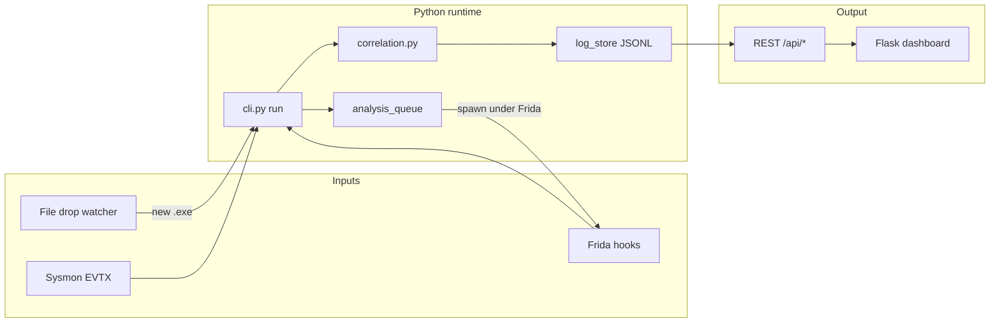

# Noirlycan — Figma design blueprint

Blueprint for recreating the full thesis telemetry project in Figma: pipeline architecture (FigJam) + interactive dashboard (Design file). Source of truth: `src/noirlycan_telemetry/dashboard/`.

## Figma file structure

Create **two files** (or one Design file with two pages):

| File / page | Type | Purpose |
|-------------|------|---------|
| `Noirlycan — Architecture` | FigJam | Data pipeline, collectors, correlation flow |
| `Noirlycan — Dashboard` | Design | All UI screens at 1440px width |

Import variables from [`design-tokens.json`](./design-tokens.json).

---

## FigJam: system architecture

### FigJam sticky zones

1. **Collectors** — Sysmon (file/process/image/access), Frida (`windows_injection_hooks.js`), file watch (`D:\`, Downloads).
2. **Primitives** — allocate, write, execute (ASIA CCS model).
3. **Enrichment** — `process_resolve.py` (PID → image), injection target column.
4. **Analysis modes** — static triage vs API spawn on drop.
5. **Dashboard tabs** — Overview, Findings, Network, Primitives, File drops, Events, Sessions.

---

## Design: global chrome

Every dashboard frame shares:

### Background
- Base: vertical gradient `#07111F` → `#040A14` → `#07111F`
- Overlay grid: 48×48px lines at 3% white opacity
- Radial glows: cyan 12% at (12%, 18%), blue 16% at (88%, 12%)

### Shell (1280px centered in 1440 artboard)
- Top margin 32px, bottom 48px

### Hero header
| Element | Spec |
|---------|------|
| Eyebrow | "WINDOWS INJECTION TELEMETRY", cyan, 11px, tracking 0.18em |
| Title | "Noirlycan Dashboard", Space Grotesk 51px bold |
| Subtitle | muted, mentions `logs/` in IBM Plex Mono |
| Actions | Session `<select>`, **Refresh** (primary gradient), **Export JSONL** (secondary) |

### Toolbar panel
- Panel card: bg `#13253D` @ 88%, border `line`, radius 22px
- Fields: Search, Severity, Target PID, Event type
- Toggles: Auto-refresh (1s)
- Buttons: Apply filters, Clear

### Tab bar
7 tabs, pill style, active tab = cyan underline + brighter fill:
Overview · Findings · Network · Primitives · File drops · Event stream · Sessions

---

## Design: screen frames

Build one frame per tab + modal. Name frames exactly as below for Code Connect later.

### 01 — Overview (`1440 × ~2200`)

**Metric cards row** (4 cards):
- Total events
- Findings
- Critical findings
- Network events

**Grid 2-col**
- Left: Donut chart "Finding severity"
- Right: Bar chart "Injection primitives" (allocate / write / execute)

**Full width**
- Line chart "Event timeline" (minute buckets)

**Grid 2-col**
- Left: Rank list "Top APIs"
- Right: Rank list "Top actors"

Sample data for realism:
- Critical finding score 100, target `msedge.exe (pid 3140)`

---

### 02 — Findings (`1440 × ~1600`)

Table columns:
| Time | Severity | Score | Injection target | APIs | Network | Description |

- Severity badges: critical=rose, high=amber, medium=blue, low=cyan
- Row hover: subtle border glow
- Hint text: "Click a row to inspect evidence…"

---

### 03 — Network (`1440 × ~1200`)

Table: Time · PID · Image · Endpoint · Protocol · Beacon?

Chip in header: "post-HIGH beacon watch"

---

### 04 — Primitives (`1440 × ~1200`)

Table: Time · Kind · API · Actor · Injection target · Address · Size

Chip: "Frida allocate / write / execute"

---

### 05 — File drops (`1440 × ~1400`)

Header chip: collector online/offline (green/cyan vs muted)

**Runtime controls** (horizontal):
- Toggle: Watch folders for new files (on)
- Toggle: Auto API analysis on drop (off)
- Hint paragraph with `run` + Frida requirement

Table: Time · Path · Score · PE · Signed · Entropy · SHA256 · Reasons · Status · Action

Action column button: **Analyze APIs**

---

### 06 — Event stream (`1440 × ~1200`)

Table: Type · Timestamp · Summary

Chip: dynamic event count

---

### 07 — Sessions (`1440 × ~1000`)

Table: File · Modified · Events · Findings · Critical · Size

Hint: "Click a session row to load it into the dashboard."

---

### 08 — Finding detail modal (`640 × ~900`, centered overlay)

Overlay: `rgba(4, 10, 20, 0.72)` + blur

Modal card:
- Header: eyebrow "FINDING DETAIL", title "Injection chain", close ×
- **Summary** — definition list (severity badge, score, target, actor, timestamps)
- **API chain** — tag pills (CreateRemoteThread, NtWriteVirtualMemory, …)
- **Evidence** — dark code block, IBM Plex Mono 12px, `#E7EEFC` text
- **Primitives** — nested mini-table
- **Related network** — nested mini-table

All modal text must use `--text` (#E7EEFC), never dark-on-dark.

---

## Component library (create in Figma)

| Component | Variants |
|-----------|----------|
| `Button/Primary` | default, hover |
| `Button/Secondary` | default, hover |
| `Button/Icon` | close |
| `Input/Text` | default, focus |
| `Input/Select` | default |
| `Input/Search` | with placeholder |
| `Toggle` | on, off |
| `Tab` | active, inactive |
| `Chip` | default, status-online, status-offline |
| `Badge/Severity` | critical, high, medium, low |
| `Panel` | default, with-head |
| `MetricCard` | default |
| `Table/Header` | — |
| `Table/Row` | default, hover, selected |
| `Tag/API` | mono pill |
| `Modal/Shell` | — |
| `CodeBlock` | evidence JSON |

---

## Build order (when Figma MCP is connected)

1. `create_new_file` → Design, name **Noirlycan — Dashboard**
2. Import color/spacing variables from `design-tokens.json`
3. Build component library (buttons, badges, panels)
4. Build shared chrome (hero + toolbar + tabs) once as `Dashboard/Chrome`
5. Duplicate chrome per tab frame; fill tab-specific content
6. Build modal as separate component, show on Findings frame variant
7. `create_new_file` → FigJam, name **Noirlycan — Architecture**
8. Paste mermaid flow as stickies/connectors
9. Optional: run `python -m noirlycan_telemetry dashboard` + `generate_figma_design` capture for pixel parity

---

## Code mapping

| Figma frame | Source |
|-------------|--------|
| Chrome | `dashboard/templates/index.html` L19–88 |
| Overview | L90–133 |
| Findings | L136–159 |
| Network | L162–187 |
| Primitives | L186–208 |
| File drops | L211–249 |
| Events | L252–270 |
| Sessions | L273–295 |
| Modal | L299–331 |
| Styles | `dashboard/static/dashboard.css` |
| Behavior | `dashboard/static/dashboard.js` |
