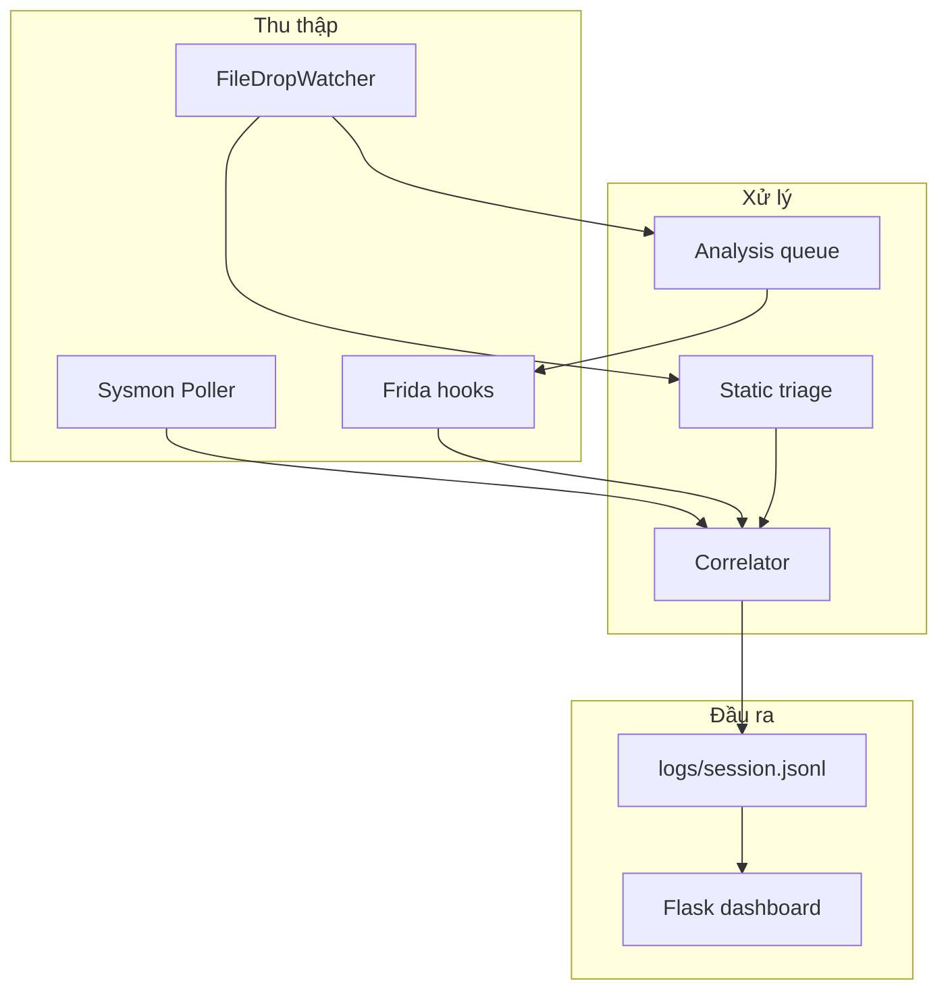

# Báo cáo: Đóng góp của Noirlycan Telemetry so với paper ASIA CCS 2025

**Paper tham chiếu:** Giorgia Di Pietro, Daniele Cono D'Elia, Leonardo Querzoni — *"Can You Run My Code? A Close Look at Process Injection in Windows Malware"* (ASIA CCS 2025, Hanoi).  
DOI: [10.1145/3708821.3736206](https://doi.org/10.1145/3708821.3736206)  
PDF: [asiaccs25.pdf](https://www.diag.uniroma1.it/delia/papers/asiaccs25.pdf)  
Mã nguồn paper: [Sap4Sec/process-injection](https://github.com/Sap4Sec/process-injection)

**Repo phân tích:** `NoirlycanThesis` — prototype telemetry cho luồng `file mới trên đĩa → lineage tiến trình → injection primitives`.

---

## 1. Tóm tắt điều hành

Paper ASIA CCS 2025 đề xuất **phương pháp phát hiện process injection** dựa trên ba *operational primitive* (allocate, write, execute), kết hợp **đồng nhất vùng nhớ** (memory range congruence) và quy tắc **ít nhất 2/3 primitive** để chịu được biến thể triển khai của malware. Tác giả triển khai framework phân tích quy mô lớn trên **56.340 mẫu malware** (2017–2023), ước lượng tỷ lệ phổ biến injection, so sánh với sandbox/AV, và công bố dataset + log thí nghiệm.

Repo **Noirlycan** không nhằm tái tạo toàn bộ nghiên cứu quy mô lớn của paper. Thay vào đó, repo **áp dụng lõi phương pháp của paper** vào một **phòng lab Windows cô lập** cho thesis, mở rộng theo hướng:

- **Provenance theo file** (Sysmon + static triage + file watcher),
- **Pipeline vận hành thời gian thực** (Frida + Sysmon + correlator + JSONL),
- **Giao diện phân tích tương tác** (web dashboard),
- **Theo dõi hậu injection** (network beacon watch, resolve PID → image).

Đây là đóng góp **engineering + mở rộng ngữ cảnh phòng thí nghiệm**, bổ sung cho paper chứ không thay thế nghiên cứu thống kê hay phân loại kỹ thuật injection ở quy mô dataset của tác giả.

---

## 2. Paper ASIA CCS 2025 — nội dung cốt lõi

### 2.1. Vấn đề nghiên cứu

Process injection là kỹ thuật then chốt để malware ẩn hành vi dưới tiến trình nạn nhân (victim). Các công trình trước thường:

- Tập trung **một kỹ thuật** hoặc dùng **behavior graph khớp chính xác API** (Starink et al.),
- Dùng **taint tracking / memory dump** — chi phí cao, khó tích hợp EDR,
- **Bỏ qua evasion**, dẫn đến **đánh giá thấp** tỷ lệ injection trong thực tế.

### 2.2. Phương pháp của paper

Paper kết hợp hai trực giác:

| Nguồn | Ý tưởng |
|-------|---------|
| Klein et al. | Injection = 3 bước: allocate → write → execute |
| Starink et al. | Các bước liên quan thao tác trên **cùng vùng nhớ** |

**Đổi mới chính của paper:**

1. **Lớp tương đương API** (*equivalence classes*) cho mỗi primitive — VirtualAllocEx và NtAllocateVirtualMemory cùng lớp *allocate*, v.v.
2. **Quy tắc 2/3 primitive** — chỉ cần quan sát **≥ 2** trong 3 primitive (có correlate theo memory) để kết luận injection; phần còn lại dùng để **phân loại kỹ thuật** nếu có đủ dữ liệu.
3. **Memory range congruence** — loại false positive khi cùng API nhưng khác vùng địa chỉ.
4. **Temporal consistency** — thứ tự allocate → write → execute (cho phép gộp bước, ví dụ section mapping).
5. **Giám sát đa tiến trình** — theo dõi chuỗi injection đệ quy (~2% mẫu trong dataset paper).
6. Chỉ cần **trace API + đối số**, không cần taint/dump — overhead thấp, phù hợp sandbox/AV.

### 2.3. Đóng góp khoa học của paper

| # | Đóng góp |
|---|----------|
| C1 | Methodology 2/3 primitive + memory congruence + API classes |
| C2 | Nghiên cứu thực nghiệm 2017–2023: ~16.5% mẫu có injection; xu hướng theo năm |
| C3 | So sánh sandbox: **21.2%** mẫu paper phát hiện mà sandbox bỏ sót |
| C4 | Tích hợp anti-evasion; ablation cho thấy evasion che injection |
| C5 | Phát hiện biến thể Process Hollowing dominant (NtCreateSection / NtMapViewOfSection) |
| C6 | Công khai code, dataset, log tại Sap4Sec/process-injection |

---

## 3. Noirlycan — kiến trúc và phạm vi

### 3.1. Mục tiêu thesis

Theo README, prototype phục vụ lab Windows 10/11 **cô lập**, correlate:

```text
new file on disk → process lineage → process injection primitives
```

Không ship payload/exploit — chỉ **đo lường phòng thủ** cho thí nghiệm thesis.

### 3.2. Thành phần chính



| Module | Vai trò |
|--------|---------|
| `injection_api_manifest.py` | Ánh xạ API → 3 primitive theo paper (+ Zw_*, memcpy mở rộng lab) |
| `frida_hooks/windows_injection_hooks.js` | Hook user-mode API, emit primitive events |
| `correlation.py` | Lõi 2/3 primitive, memory congruence, scoring, network watch |
| `sysmon.py` + `configs/sysmon-noirlycan.xml` | File create, process create, access, network |
| `file_watch.py` + `triage.py` | Phát hiện file mới, SHA256, entropy, PE, signature |
| `analysis_queue.py` | Hàng đợi spawn EXE dưới Frida khi file drop |
| `process_resolve.py` | PID → đường dẫn image (Windows API) |
| `dashboard/` | UI tương tác: findings, primitives, network, file drops |

---

## 4. Mức độ bám sát phương pháp paper

### 4.1. Ba operational primitive

Repo định nghĩa rõ trong `models.py`:

```python
class PrimitiveKind(str, Enum):
    ALLOCATE = "allocate"
    WRITE = "write"
    EXECUTE = "execute"
```

`injection_api_manifest.py` ghi chú trực tiếp nguồn paper và liệt kê **PAPER_API_CLASSES** — VirtualAllocEx, NtCreateSection, NtMapViewOfSection, ResumeThread, v.v. — khớp với Appendix / §3 của paper.

### 4.2. Quy tắc ≥ 2 primitive

`correlation.py` — `_find_injection_chains()`:

```python
kinds = {primitive.kind for primitive in primitives}
if len(kinds) < 2:
    continue
```

Test `test_requires_two_distinct_primitives` xác nhận một primitive đơn lẻ **không** tạo finding — đúng tinh thần paper.

### 4.3. Memory range congruence

`_has_memory_congruence()` kiểm tra overlap vùng địa chỉ giữa primitive khác loại. Test `test_rejects_unrelated_memory_ranges` — WRITE tại `0x1000` và EXECUTE tại `0x5000` **không** correlate — khớp mục đích giảm false positive của paper.

### 4.4. Temporal consistency

`_has_temporal_consistency()` ép thứ tự allocate(0) → write(1) → execute(2), cho phép allocate lặp nhưng không đảo ngược logic — tương đương §3.2 paper.

### 4.5. Ví dụ section-mapping (Process Hollowing biến thể)

Paper mô tả mẫu *neurevt*: NtCreateSection + NtMapViewOfSection (local + remote) thay cho allocate/write tách rời. Repo test `test_detects_section_mapping_write_execute_chain` với NtMapViewOfSection + ResumeThread trên `msedge.exe` — **trực tiếp phản ánh** case study trong paper.

### 4.6. Bảng đối chiếu phương pháp

| Tiêu chí paper | Noirlycan | Mức khớp |
|----------------|-----------|----------|
| 3 primitive allocate/write/execute | Có (`PrimitiveKind`) | **Đầy đủ** |
| API equivalence classes | `PAPER_API_CLASSES` + hooks Frida | **Đầy đủ** (lab subset) |
| Quy tắc ≥ 2/3 primitive | `len(kinds) < 2` → bỏ qua | **Đầy đủ** |
| Memory congruence | `_has_memory_congruence` | **Đầy đủ** |
| Temporal ordering | `_has_temporal_consistency` | **Đầy đủ** |
| Đa tiến trình / recursive chain | Auto-attach Frida, theo actor/target PID | **Một phần** (chưa mô hình hóa chain đệ quy rõ) |
| Phân loại kỹ thuật injection (12 techniques) | Không có classifier riêng | **Thiếu** |
| Anti-evasion integration | Không | **Thiếu** |
| Dataset + thống kê prevalence | Không | **Ngoài phạm vi** |
| So sánh sandbox/AV | Không | **Ngoài phạm vi** |

---

## 5. Đóng góp mới của repo (vượt paper)

### 5.1. Chuỗi provenance theo file (đóng góp thesis chính)

Paper tập trung **injection trong execution trace**; Noirlycan mở rộng **ngữ cảnh nguồn gốc file**:

| Khả năng | Mô tả |
|----------|--------|
| Sysmon Event ID 11 | File create — biết file nào vừa xuất hiện |
| Static triage | SHA256, PE, Authenticode, entropy, import đáng ngờ |
| File drop watcher | Poll thư mục (D:\, Downloads, Desktop, …) |
| Liên kết file ↔ process | `add_process()` gắn `created_from_file`; `_related_file_for_process()` |
| Scoring bổ sung | +10 related file, +5 PE, +10 unsigned, +5 entropy ≥ 7 |

Điều này phục vụ so sánh hai mô hình loader trong README:

```text
memory-only loader:  payload nhúng → section mapping → ResumeThread
file-dropping loader: FileCreate → ProcessCreate → injection primitives
```

Paper **không** xây pipeline end-to-end cho kịch bản lab “copy EXE → quan sát injection” như repo.

### 5.2. Kiến trúc telemetry kép Sysmon + Frida

| Nguồn | Bổ sung cho paper |
|-------|-------------------|
| **Frida** | API-level NT/user (paper cũng trace API, nhưng repo dùng Frida lab — dễ triển khai thesis) |
| **Sysmon** | Process lineage, ProcessAccess, ImageLoad, Network — paper không dùng Sysmon làm nguồn chính |

Sysmon **không thấy** mọi NT syscall (README nêu rõ); Frida lấp chỗ trống. Kết hợp hai nguồn là **đóng góp kiến trúc thu thập** cho môi trường Windows thực nghiệm.

### 5.3. Pipeline vận hành và phân tích tự động

| Tính năng | Ý nghĩa |
|-----------|---------|
| `run` / `spawn` CLI | Vòng lặp correlate thời gian thực, JSONL session |
| `analysis_queue.py` | File drop → spawn dưới Frida (API analysis) |
| Runtime config + dashboard toggle | Bật/tắt watch folder, auto API analysis không cần restart |
| Network beacon watch | Sau finding HIGH/CRITICAL, theo dõi PID target 5 phút, Sysmon Event ID 3 |

Paper đề cập network ở mức phân tích malware tổng thể; repo **tự động hóa** bước “sau injection, victim có kết nối ra ngoài không?” trong lab.

### 5.4. Làm giàu finding cho analyst

| Trường | Nguồn |
|--------|-------|
| `actor_image` / `target_image` | Sysmon + `process_resolve.py` + Frida PID cache |
| `evidence` | APIs, cross_process, section_mapping, create_suspended, related_file |
| Severity score 0–100 | Heuristic lab (không có trong paper) |
| Web dashboard | Overview charts, modal evidence, export JSONL |

Paper xuất kết quả phân tích batch; repo xuất **session JSONL + UI** cho từng thí nghiệm thesis.

### 5.5. Mở rộng API hook (lab)

`REPO_EXTRA_APIS` — Zw_* aliases, VirtualAlloc, memcpy — hỗ trợ malware dùng syscall stub hoặc copy local trước map remote. Đây là **mở rộng thực dụng lab**, không phải claim khoa học mới.

---

## 6. Hạn chế so với paper

| Hạn chế paper nêu | Noirlycan |
|-------------------|-----------|
| User-space only | **Cùng phạm vi** — Frida user-mode |
| Instrumentation có thể bị evade | **Rủi ro cao hơn** — Frida dễ bị phát hiện hơn framework paper |
| Direct syscall / unhooking | README thừa nhận — có thể bypass hook |
| Không kernel-mode injection | Không hỗ trợ |

| Khả năng paper có, repo chưa | Ghi chú |
|------------------------------|---------|
| Phân loại 12 injection techniques | Chỉ có primitive + evidence flags |
| Nghiên cứu 56k mẫu, thống kê theo năm | Ngoài phạm vi thesis prototype |
| So sánh Cuckoo/VirusTotal sandbox | Không triển khai |
| Tích hợp anti-evasion | Không |
| Recursive injection chain analytics | Auto-attach một phần; chưa metric 2% như paper |
| Dataset công khai + reproducibility ở quy mô paper | Chỉ JSONL session cục bộ |

---

## 7. Bảng tổng hợp: Paper vs Noirlycan

| Khía cạnh | ASIA CCS 2025 (paper) | Noirlycan (repo) |
|-----------|----------------------|------------------|
| **Mục tiêu** | Hiểu prevalence + phát hiện injection ở quy mô malware | Lab thesis: file → process → injection |
| **Lõi detection** | 2/3 primitive + memory congruence | **Kế thừa** (`correlation.py`) |
| **API classes** | Equivalence classes đầy đủ | **Kế thừa** (`injection_api_manifest.py`) |
| **Instrumentation** | Framework trace API (paper implementation) | **Frida** + **Sysmon** |
| **File provenance** | Không trọng tâm | **Đóng góp chính** |
| **Static analysis** | Không | Triage PE/entropy/signature |
| **UI / vận hành** | Batch analysis | CLI + **web dashboard** |
| **Post-injection network** | Không tự động trong methodology | **Beacon watch** 5 phút |
| **Quy mô đánh giá** | 56.340 mẫu, 2.667 families | Thí nghiệm đơn lẻ (loader, msedge, …) |
| **Đầu ra** | Dataset, logs, thống kê | `logs/*.jsonl`, findings có score |

---

## 8. Kết luận cho thesis

### 8.1. Vị trí của Noirlycan trong bức tranh nghiên cứu

Noirlycan **không** claim phương pháp phát hiện injection mới thay thế ASIA CCS 2025. Repo **căn cứ có chủ đích** vào methodology của paper (thể hiện qua `injection_api_manifest.py`, tests correlation, và README) và **dịch chuyển** phương pháp đó sang:

1. **Môi trường lab Windows có Sysmon**,  
2. **Kịch bản loader thực nghiệm** (file-drop vs memory-only),  
3. **Công cụ quan sát và báo cáo** phục vụ luận văn.

### 8.2. Đóng góp có thể trình bày trong báo cáo thesis

| STT | Đóng góp | Loại |
|-----|----------|------|
| 1 | Triển khai lõi 2/3 primitive + memory congruence của Di Pietro et al. trên Frida | **Implementation / validation** |
| 2 | Mở rộng correlate **file provenance + process lineage + injection** | **Extension** |
| 3 | Kiến trúc **Sysmon ∪ Frida** cho lab Windows 10/11 | **Engineering** |
| 4 | Pipeline **file drop → static triage → optional API spawn** | **Operational workflow** |
| 5 | Dashboard + JSONL + network watch cho phân tích tương tác | **Tooling** |
| 6 | Case study: section-mapping vào `msedge.exe` (khớp biến thể paper nhấn mạnh) | **Empirical demo** |

### 8.3. Hướng mở rộng (nếu thesis cần gần paper hơn)

- Thêm **classifier kỹ thuật** (Process Hollowing, DLL injection, …) khi đủ 3 primitive — dùng evidence flags hiện có (`section_mapping`, `create_suspended`, …).
- Chạy **batch** trên tập mẫu nhỏ (VX Underground / VirusTotal academic subset) và so sánh recall với paper — không cần 56k mẫu.
- Ghi nhận **recursive injection** như metric riêng (paper: 2%).
- Tài liệu hóa **limitation Frida vs instrumentation paper** trong phần threat model.

---

## 9. Tài liệu tham khảo

1. Di Pietro, G., D'Elia, D. C., & Querzoni, L. (2025). *Can You Run My Code? A Close Look at Process Injection in Windows Malware.* ASIA CCS 2025. https://doi.org/10.1145/3708821.3736206  
2. Sap4Sec/process-injection — artifacts paper. https://github.com/Sap4Sec/process-injection  
3. Klein, S., et al. — catalog 3 primitive (trích dẫn trong paper).  
4. Starink, T., et al. (2023) — behavior graphs, memory congruence (tiền thân paper).  
5. NoirlycanThesis — `README.md`, `src/noirlycan_telemetry/correlation.py`, `injection_api_manifest.py`, `tests/test_correlation.py`.

---

*Báo cáo soạn cho luận văn Noirlycan — đối chiếu implementation với ASIA CCS 2025, không thay thế đọc kỹ paper gốc.*
