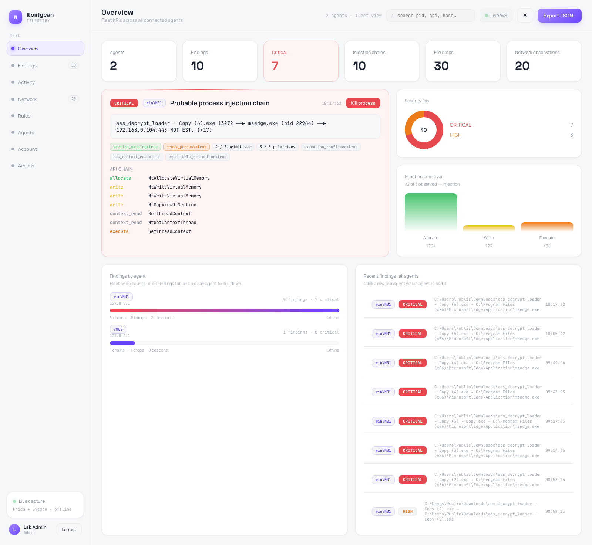
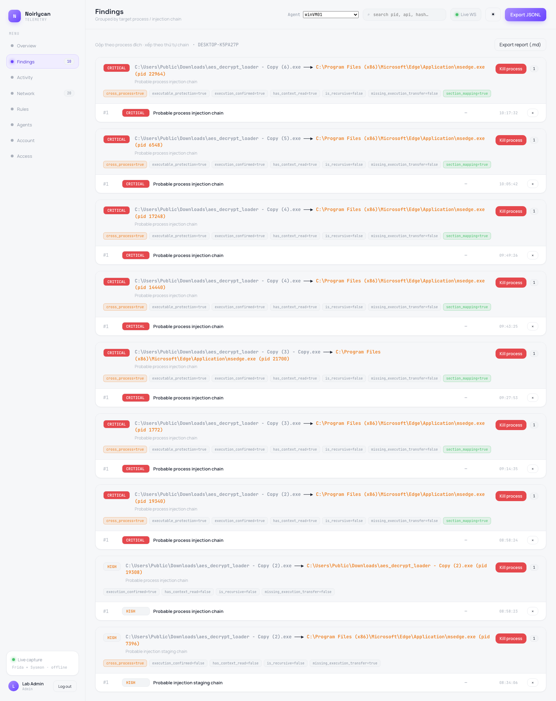
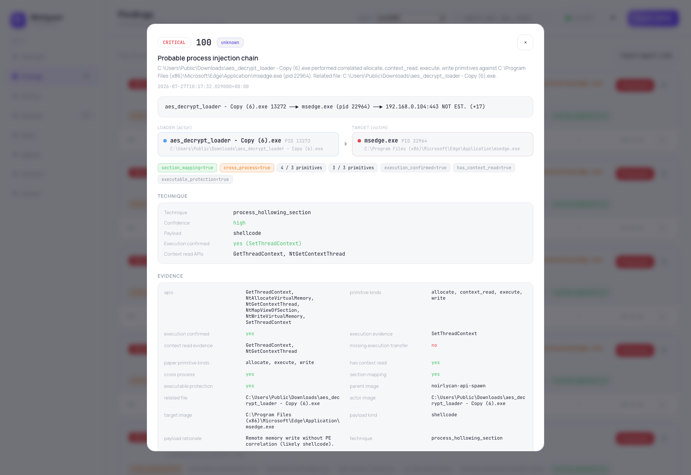
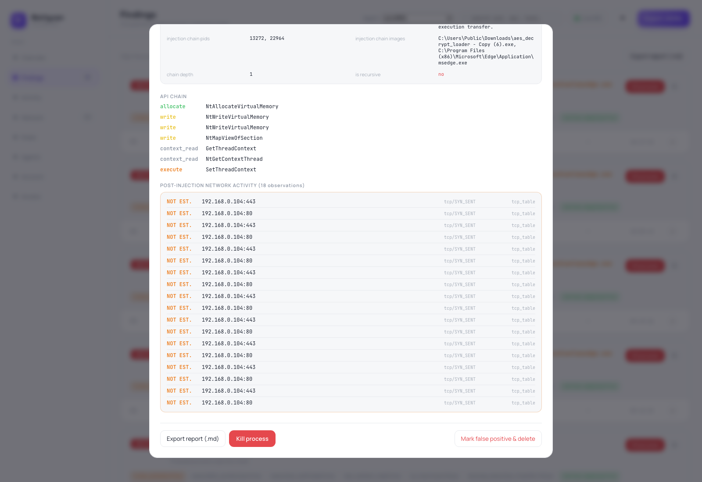
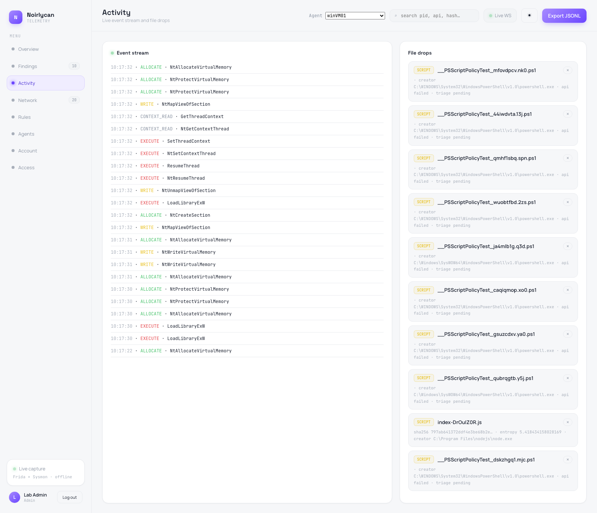
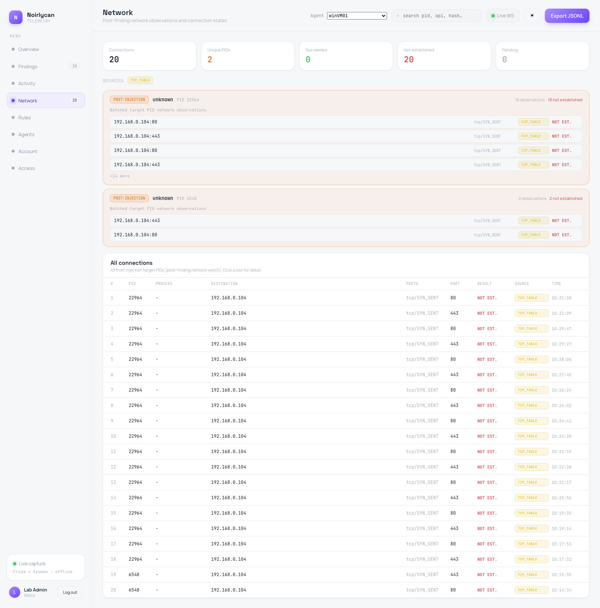
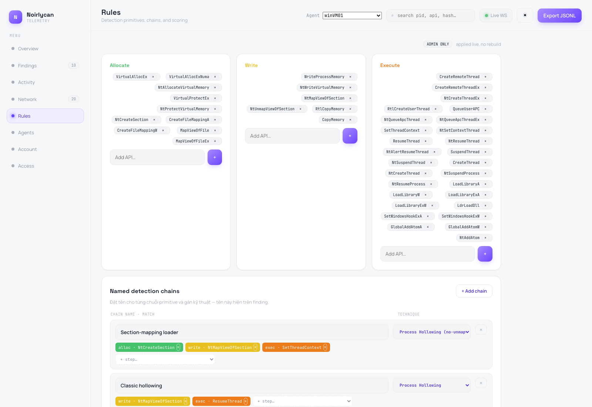
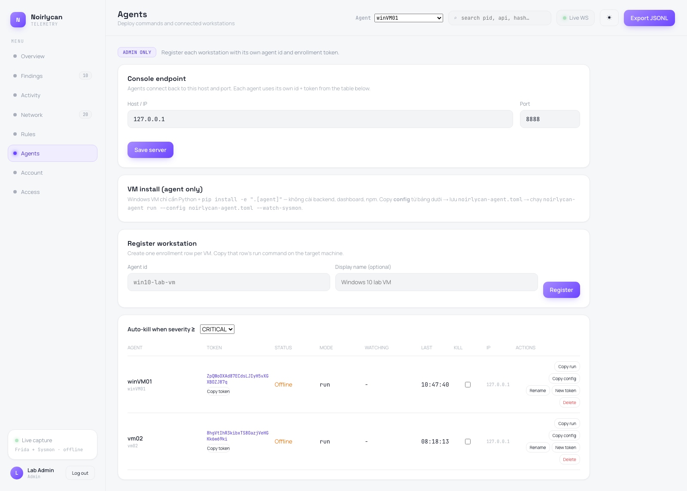

# TĂNG CƯỜNG PHÁT HIỆN MÃ ĐỘC TRƯỚC CÁC KĨ THUẬT NÉ TRÁNH

**BÁO CÁO TÓM LƯỢC LUẬN VĂN THẠC SĨ**

**Học viên:** Phan Văn Cơ
**Chuyên ngành:** An toàn thông tin
**Cán bộ hướng dẫn:** [Chức danh, họ tên cán bộ hướng dẫn]
**Đơn vị đào tạo:** Trường Đại học Công nghệ, Đại học Quốc gia Hà Nội
**Hệ thống được xây dựng:** Noirlycan Telemetry
**Môi trường thực nghiệm:** Windows 10/11 VM cô lập

\newpage

## TÓM TẮT

Mã độc trên Windows ngày nay thường không để lộ hết chức năng ngay trong chương trình đầu tiên mà nó tạo ra. Thay vào đó, nó giải mã phần mã độc thật trong bộ nhớ, rồi ghi phần mã đó sang một chương trình khác đang chạy, và cuối cùng ra lệnh cho chương trình kia chạy đoạn mã vừa ghi vào. Nhóm hành vi này được tổ chức MITRE xếp vào một kĩ thuật tấn công có tên process injection (kĩ thuật chèn mã độc vào một chương trình đang chạy khác để ẩn mình), mã phân loại là T1055 (mã phân loại kĩ thuật tấn công của tổ chức MITRE). Khi mã độc mượn danh một chương trình hợp pháp để chạy, nó làm giảm hiệu quả của những cách nhận diện kiểu cũ dựa trên một mẫu cố định — ví dụ nhận diện theo tệp, theo tên hàm cố định, hay theo nguồn gốc chương trình. Đó chính là lý do luận văn chọn hướng nghiên cứu: tăng cường khả năng phát hiện những biến thể né tránh liên quan đến process injection.

Cơ sở khoa học chính của luận văn là công trình của Di Pietro, D'Elia và Querzoni công bố tại hội nghị ASIA CCS 2025 [4]. Trong công trình đó, việc chèn mã được mô tả gọn lại thành ba bước cơ bản, ở đây gọi là ba nguyên hàm allocate–write–execute: (1) xin một vùng nhớ trong chương trình đích, (2) ghi mã độc vào vùng đó, và (3) ra lệnh chạy mã đó. Thay vì đòi hỏi phải khớp đúng một chuỗi tên hàm cụ thể, cách làm này báo động khi nhìn thấy ít nhất hai trong ba nguyên hàm allocate–write–execute xảy ra giữa cùng một cặp chương trình. Đây gọi là quy tắc: chỉ cần thấy ít nhất 2 trong 3 nguyên hàm allocate–write–execute là đủ để nghi ngờ. Ngoài ra hệ thống còn kiểm tra thêm xem các bước có cùng thao tác trên một vùng nhớ hay không, và thứ tự thời gian giữa các bước có hợp lý không. Trên nền tảng đó, luận văn xây dựng hệ thống Noirlycan Telemetry, gồm một chương trình thu thập chạy trên Windows, một phần mềm nền web (FastAPI), một cơ sở dữ liệu, và một bảng điều khiển (dashboard, giao diện web React). Chương trình thu thập kết hợp hai nguồn telemetry bổ sung cho nhau: Frida (công cụ theo dõi các lệnh mà một chương trình gọi tới hệ điều hành) cho biết chi tiết từng lệnh gọi hàm hệ thống (API) và các tham số ở chế độ người dùng (user mode), còn Sysmon (công cụ ghi nhật ký hoạt động hệ thống của Windows) cho biết dữ liệu ở mức toàn hệ thống như việc tạo chương trình mới, tạo tệp, truy cập vào chương trình khác và kết nối mạng. Correlator gộp các sự kiện lại thành chuỗi gồm actor và target, quy các lệnh gọi hàm về ba nguyên hàm allocate–write–execute, tính điểm số và tạo cảnh báo.

Kết quả thực nghiệm hiện tại vẫn chỉ giới hạn ở **một loader do chính tác giả tự viết**, nhưng chương trình này đã được chạy đi chạy lại dưới nhiều tên tệp bản sao trên hai máy thu thập. Dữ liệu mới lấy về từ máy Windows ghi nhận rõ actor là `aes_decrypt_loader - Copy (6).exe` (PID 13272) và target là `msedge.exe` (PID 22964), thay cho việc trước đây không xác định được target. Correlator nhìn thấy đủ cả ba nguyên hàm allocate–write–execute, chấm điểm 100 và tạo một cảnh báo mức CRITICAL với các bằng chứng: hành vi xảy ra giữa hai chương trình khác nhau (`cross_process`), có ghi mã qua cơ chế ánh xạ vùng nhớ chung (`section_mapping`), có đọc bối cảnh luồng (`has_context_read`) và có xác nhận chạy mã (`execution_confirmed`). Trong máy ảo cô lập, loader không bị Windows Defender và Kaspersky chặn trong những lần chạy quan sát được. Cần nhấn mạnh: cảnh báo này phản ánh kết quả của quy tắc ghép nối, chứ không phải bằng chứng độc lập rằng mọi lệnh gọi hàm đã thành công hay đoạn mã độc chắc chắn đã chạy. Kết quả cho thấy việc giám sát hành vi có thể bổ sung cho lớp phần mềm diệt virus (AV) dựa trên tệp và mẫu cố định, chứ không thay thế hoàn toàn lớp đó.

Phần theo dõi mạng đã có dữ liệu chạy thông suốt từ bộ quan sát bảng kết nối TCP. Sau khi có cảnh báo, dashboard ghi nhận 20 bản ghi của hai target, đều gửi tới `192.168.0.104` trên cổng 80 và 443. Tất cả đều ở trạng thái `tcp/SYN_SENT`, tức là chương trình mới GỬI yêu cầu kết nối ra ngoài nhưng CHƯA kết nối thành công. Do đó, dữ liệu này chỉ chứng minh **có các nỗ lực kết nối ra ngoài sau khi chèn mã**, chưa chứng minh kết nối thật sự thành công, cũng chưa chứng minh có tín hiệu mã độc gọi về máy chủ điều khiển của kẻ tấn công. Hướng tiếp theo là đối chiếu thêm với nhật ký WFP (sự kiện 5156/5157) và Sysmon (sự kiện EID 3), bổ sung tên chương trình và tên máy chủ, phân tích chu kỳ lặp và xác nhận đích đến bằng dữ liệu chuẩn đã biết trước. Song song, hệ thống cần được thử nghiệm trên nhiều loader thật sự khác nhau, thay vì chỉ chạy lại nhiều bản sao của cùng một chương trình.

**Từ khóa:** mã độc né tránh, process injection, ba nguyên hàm allocate–write–execute, Frida, Sysmon, telemetry, phát hiện theo hành vi, Noirlycan.

---

## TUYÊN BỐ VỀ PHẠM VI VÀ TÍNH NGUYÊN BẢN

Báo cáo này được tác giả viết lại bằng lời của mình, dựa trên mã nguồn Noirlycan, dữ liệu thực nghiệm và các tài liệu đã trích dẫn. Mọi khái niệm hay con số lấy từ công trình khác đều được ghi rõ nguồn. Đặc biệt cần nhấn mạnh: quy mô 56.340 mẫu, tỉ lệ chèn mã khoảng 16,5% và tỉ lệ hộp cát (sandbox) bỏ sót 21,2% là kết quả của Di Pietro và cộng sự [4], KHÔNG phải kết quả đo được của hệ thống Noirlycan.

Các kết luận thực nghiệm của luận văn chỉ đúng cho cấu hình phòng thí nghiệm đã mô tả. Việc loader không bị Defender và Kaspersky chặn chỉ là quan sát trên một công cụ tự viết, mới toanh, tại một thời điểm thử nghiệm cụ thể. Không được hiểu điều này thành khả năng vượt qua mọi phiên bản hay mọi cấu hình phần mềm diệt virus (AV), và cũng không được hiểu thành nhận định rằng năng lực chống mã độc thật của hai hãng này yếu — một chương trình tự viết, chưa từng xuất hiện trước đó, đương nhiên chưa có mẫu nhận diện nên khó bị chặn hơn một mẫu mã độc phổ biến. Tương tự, một cảnh báo CRITICAL chứng minh hệ thống đã phát hiện được ca thử nghiệm này, nhưng chưa đủ để suy ra tỉ lệ đúng/sai hay hiệu quả trên một lượng lớn mã độc.

\newpage

## MỤC LỤC NỘI DUNG

Báo cáo gồm sáu chương: (1) mở đầu và vấn đề nghiên cứu; (2) cơ sở lý thuyết và phương pháp tăng cường phát hiện; (3) thiết kế, hiện thực và quy tắc ra quyết định của Noirlycan; (4) thực nghiệm và kết quả; (5) thảo luận, giới hạn và hướng phát triển; (6) kết luận — kèm tài liệu tham khảo và phụ lục ở cuối.

\newpage

## BẢNG THUẬT NGỮ

*(Thuật ngữ kĩ thuật dùng xuyên suốt báo cáo, xếp theo thứ tự xuất hiện. Từ lần dùng đầu tiên trong mỗi chương, có thể chỉ viết thuật ngữ mà không giải thích lại.)*

| Thuật ngữ | Giải thích ngắn gọn |
|-----------|----------------------|
| Loader (chương trình mồi) | Chương trình nhỏ có nhiệm vụ tải và khởi chạy phần mã độc thật; bản thân nó có thể trông vô hại |
| Process injection (chèn mã) | Kĩ thuật đưa mã vào một chương trình đang chạy khác rồi cho chạy dưới danh nghĩa chương trình đó |
| Operational primitive (nguyên hàm) | Ba thao tác cơ bản mọi kĩ thuật chèn mã đều quy về được: allocate, write, execute |
| Allocate | Xin cấp phát một vùng nhớ (hoặc vùng chung) có thể chứa mã trong chương trình đích |
| Write | Ghi/đưa nội dung (mã độc) vào vùng nhớ vừa xin được |
| Execute | Chuyển quyền điều khiển CPU sang chạy đoạn mã vừa ghi |
| 2-of-3 (quy tắc 2 trong 3) | Chỉ cần quan sát được ít nhất 2 trong 3 nguyên hàm trên là đủ để nghi ngờ có chèn mã |
| Equivalence class (lớp tương đương) | Gom nhiều hàm API khác tên nhưng cùng mục đích vào một nhóm, để không phụ thuộc tên hàm cụ thể |
| Memory congruence (tương hợp vùng nhớ) | Kiểm tra các bước có cùng thao tác trên một vùng nhớ hay không |
| Temporal ordering (thứ tự thời gian) | Kiểm tra trình tự thời gian giữa các bước có hợp lý không (allocate trước, execute sau) |
| Actor | Chương trình/tiến trình thực hiện hành vi chèn mã |
| Target | Chương trình/tiến trình bị nhắm tới, nhận vùng nhớ hoặc luồng thực thi bị điều khiển |
| Correlator (bộ tương quan) | Thành phần ghép các sự kiện rời rạc thành một chuỗi hành vi rồi tính điểm, ra quyết định |
| Finding (cảnh báo/phát hiện) | Kết quả cuối cùng khi một chuỗi hành vi vượt ngưỡng điểm quy định |
| Severity/score (mức độ nghiêm trọng/điểm số) | Thang đánh giá mức độ đáng ngờ của một cảnh báo (MEDIUM/HIGH/CRITICAL) |
| User mode (chế độ người dùng) | Mức chạy của phần lớn ứng dụng thông thường, nơi Frida quan sát được |
| Kernel mode (chế độ nhân) | Mức lõi hệ điều hành; Sysmon lấy dữ liệu gần mức này hơn Frida |
| Direct syscall (gọi hệ thống trực tiếp) | Cách mã độc tự gọi thẳng xuống lõi hệ điều hành để né công cụ theo dõi cài ở user mode |
| Provenance (truy vết nguồn gốc) | Xác định tệp/tiến trình nào là nguồn gốc tạo ra một hành vi hoặc chương trình khác |
| Telemetry (dữ liệu viễn trắc/giám sát) | Dữ liệu thu thập được về hành vi hệ thống, phục vụ phát hiện |
| Dashboard (bảng điều khiển) | Giao diện web hiển thị cảnh báo và dữ liệu giám sát cho người phân tích |
| API (giao diện lập trình ứng dụng) | Hàm hệ thống mà chương trình gọi để yêu cầu hệ điều hành thực hiện một việc |
| AV (phần mềm diệt virus) | Antivirus — phần mềm phát hiện mã độc chủ yếu dựa trên chữ ký tệp |
| EDR | Endpoint Detection and Response — hệ thống giám sát và phản ứng theo hành vi trên máy đầu cuối |
| XDR | Extended Detection and Response — bản mở rộng của EDR, tổng hợp thêm dữ liệu mạng/cloud, nhưng logic phát hiện bên trong vẫn phần lớn là hộp đen của nhà cung cấp |
| SOC | Security Operations Center — đội vận hành an ninh, nơi phân tích và xử lý cảnh báo |
| C2 (máy chủ điều khiển) | Command-and-Control — hạ tầng kẻ tấn công dùng để điều khiển mã độc từ xa |
| Beacon/callback (tín hiệu C2) | Tín hiệu định kỳ mã độc gửi về máy chủ điều khiển sau khi xâm nhập thành công |
| SYN_SENT / ESTABLISHED | Hai trạng thái kết nối TCP: đã gửi yêu cầu nhưng chưa xác nhận / đã thiết lập thành công |
| Sysmon | Công cụ ghi nhật ký hoạt động hệ thống của Windows (Microsoft Sysinternals) |
| Frida | Công cụ theo dõi và can thiệp lệnh gọi hàm của một chương trình đang chạy, ở user mode |

\newpage

## DANH MỤC CÁC BẢNG

*(Cột Trang: điền sau khi dàn trang trong Word — Tham chiếu → Insert Table of Figures, chọn style "Bảng".)*

| Số | Tên bảng | Trang |
|----|----------|------:|
| 1.1 | Mục tiêu nghiên cứu và trạng thái đạt được | |
| 1.2 | Giả thuyết nghiên cứu và kết luận hiện tại | |
| 3.1 | Lớp tương đương API theo `api_manifest.py` | |
| 3.2 | Sáu cửa kiểm tra trước khi tạo cảnh báo | |
| 3.3 | Công thức cộng điểm trong `_score()` | |
| 3.4 | Ngưỡng phân loại mức độ nghiêm trọng | |
| 3.5 | Mức bao phủ của bộ phân loại theo `taxonomy.py` | |
| 3.6 | Chi tiết mức bao phủ theo từng kĩ thuật (`taxonomy.py`) | |

\newpage

## DANH MỤC CÁC HÌNH

*(Đầu đề hình ghi phía dưới hình. Cột Trang: điền sau khi dàn trang trong Word.)*

| Số | Tên hình | Trang |
|----|----------|------:|
| 1 | Tổng quan các chỉ số và cảnh báo CRITICAL (Overview) | |
| 2 | Cảnh báo với cặp actor–target và bằng chứng (Findings) | |
| 3 | Chi tiết cảnh báo sau khi mở | |
| 4 | Chuỗi lệnh gọi hàm và bằng chứng mạng trong cảnh báo | |
| 5 | Dòng thời gian các bước (Activity) | |
| 6 | Nỗ lực kết nối mạng sau cảnh báo (Network) | |
| 7 | Chính sách ghép nối (Rules) | |
| 8 | Máy thu thập vm01 (Agents) | |

\newpage

# 1. MỞ ĐẦU VÀ VẤN ĐỀ NGHIÊN CỨU

## 1.1. Bối cảnh

**Loader là gì?** Loader (loader) là một chương trình nhỏ, thường có một nhiệm vụ duy nhất: tải và khởi chạy phần mã độc thật sự. Phần mã độc đó thường được kẻ tấn công mã hóa hoặc nén lại từ trước để giấu đi, và bản thân tệp loader nhìn bằng mắt thường hoặc quét sơ bộ có thể trông vô hại, thậm chí không có mã độc lộ ra ở dạng đọc được trên đĩa. Loader là bước đầu tiên trong chuỗi tấn công: nó không nhất thiết phải "độc hại rõ ràng", nhiệm vụ của nó chỉ là mở đường cho phần mã thật chạy được mà không bị chặn.

**Vì sao loader hay dùng process injection để né phần mềm diệt virus (AV) và hệ thống giám sát đầu cuối (EDR)?** Có ba lý do chính. Một, nếu mã độc chỉ tồn tại trong bộ nhớ sau khi được giải mã, chứ không bao giờ ghi ra đĩa ở dạng rõ ràng, thì việc quét tệp theo chữ ký gần như vô dụng — không có gì để quét. Hai, khi loader chèn mã vào một chương trình hợp pháp và đã có chữ ký số như `msedge.exe` hay `explorer.exe`, hành vi mạng hoặc hành vi hệ thống sau đó sẽ hiện ra dưới tên của chương trình hợp pháp đó, khiến các luật lọc theo tên chương trình của AV/EDR bị vô hiệu — EDR thấy "msedge.exe kết nối mạng" chứ không thấy "loader lạ kết nối mạng". Ba, nhiều loader hiện đại còn tự gọi hệ thống trực tiếp (direct syscall) (né hook mà EDR cài ở chế độ người dùng (user mode)) hoặc dò tìm dấu hiệu máy ảo/công cụ theo dõi để không chạy nếu nghi ngờ đang bị phân tích.

Đây chính là lý do luận văn không đi theo hướng quét tệp theo chữ ký, mà chọn hướng theo dõi **hành vi** của chương trình khi nó đang chạy — cụ thể là hành vi chèn mã (process injection).

Cách phát hiện mã độc truyền thống thường bắt đầu từ chính tệp: mã băm (hash), mẫu chữ ký, cấu trúc tệp thực thi, chuỗi kí tự hay mẫu byte. Cách này vẫn quan trọng, nhưng gặp khó khi kẻ tấn công nén và mã hóa mã độc, tạo ra nhiều biến thể, hoặc chỉ khôi phục mã độc trong bộ nhớ. Khi đoạn mã độc không nằm ở dạng rõ ràng trên đĩa, thông tin tĩnh trên tệp có thể không đủ để ra quyết định.

Process injection làm vấn đề khó hơn. Thay vì tạo một chương trình mang tên đáng ngờ, loader có thể mở một chương trình hợp pháp, chuẩn bị vùng nhớ trong chương trình đó, ghi mã độc vào, rồi điều khiển một luồng thực thi chạy đoạn mã ấy. Nhìn từ phía người dùng, hành vi cuối cùng có thể hiện ra dưới tên một trình duyệt hay một chương trình hệ thống. Nhìn từ phía người phòng thủ, nguồn gốc thật của hành vi bị che giấu.

Khó khăn này lộ rõ khi so với cách viết quy tắc kiểu cũ. Một quy tắc theo tên hàm kiểu cũ có thể đòi hỏi đúng chuỗi `VirtualAllocEx → WriteProcessMemory → CreateRemoteThread`. Quy tắc này dễ hiểu, nhưng lệ thuộc vào tên hàm chính xác. Khi loader thay `VirtualAllocEx` bằng `NtAllocateVirtualMemory`, thay thao tác ghi bằng `NtMapViewOfSection`, hoặc thay bước tạo luồng từ xa bằng `SetThreadContext` và `ResumeThread`, thì chuỗi tên hàm không còn giống mẫu ban đầu — dù mục đích vẫn y hệt: chuẩn bị, đưa vào và chạy mã trong chương trình đích. Vì vậy, vấn đề nghiên cứu không phải là theo dõi thêm thật nhiều hàm, mà là tìm một cách mô tả hành vi ít lệ thuộc vào tên hàm và có thể gộp được nhiều nguồn quan sát lại với nhau. Luận văn chọn cách mô tả theo ba nguyên hàm allocate–write–execute và triển khai trên một máy Windows thật trong phòng thí nghiệm.

## 1.2. Câu hỏi nghiên cứu

Câu hỏi trung tâm của luận văn là: làm thế nào tăng cường khả năng phát hiện process injection khi mã độc đổi tên hàm, gộp các bước lại, che nguồn gốc chương trình, hoặc né được công cụ theo dõi ở chế độ người dùng (user mode) — tất cả trong một hệ thống phòng thí nghiệm có thể quan sát và làm lại được?

Câu hỏi này được chia thành năm mục tiêu nghiên cứu (RO1–RO5), tóm tắt tại **Bảng 1.1**.

**Bảng 1.1.** Mục tiêu nghiên cứu và trạng thái đạt được

| Mã | Mục tiêu | Trạng thái |
|----|----------|------------|
| RO1 | Xây dựng phương pháp allocate–write–execute cùng quy tắc 2-of-3 | Đã đạt |
| RO2 | Kết hợp Frida và Sysmon để bao phủ rộng hơn | Đạt một phần |
| RO3 | Liên kết tệp rơi xuống máy, chương trình và cảnh báo | Đạt một phần |
| RO4 | Thử nghiệm trên nhiều biến thể chèn mã | Đạt một phần (mới có một loader thật) |
| RO5 | Xác định mô hình mối đe dọa và ranh giới của kết luận | Đã đạt |

## 1.3. Giả thuyết nghiên cứu

Luận văn đặt ra năm giả thuyết đi cùng năm mục tiêu trên (**Bảng 1.2**).

**Bảng 1.2.** Giả thuyết nghiên cứu và kết luận hiện tại

| Mã | Giả thuyết | Kết luận |
|----|-----------|----------|
| H1 | Gom nhiều tên hàm khác nhau về cùng một nguyên hàm giúp phát hiện biến thể đổi tên hàm | Ủng hộ |
| H2 | Quy tắc 2-of-3 giúp nhận ra chuỗi ánh xạ vùng nhớ dù một bước kiểu cũ bị gộp hoặc không quan sát được | Ủng hộ |
| H3 | Truy vết nguồn gốc (provenance) và chương trình giúp giải thích được nguồn của chuỗi chèn mã | Củng cố một phần |
| H4 | Sysmon bổ sung quan hệ cha–con và tín hiệu phụ khi Frida bị né | Chưa có phép đo đối chứng |
| H5 | Frida cung cấp telemetry đủ ổn định cho phòng thí nghiệm Windows | Chưa đo tỉ lệ mất sự kiện |

Kết quả mới tiếp tục ủng hộ H1 và H2. H3 được củng cố qua các lần chạy mới, vì cảnh báo đã liên kết được đường dẫn loader với target là `msedge.exe`; tuy vậy cần kiểm tra thêm trên loader khác trước khi kết luận rộng hơn. H4 chưa có phép đo đối chứng cho tình huống gọi hệ thống trực tiếp (direct syscall). H5 chưa có phép đo tỉ lệ mất sự kiện một cách bài bản.

## 1.4. Đóng góp

Luận văn có bốn đóng góp chính. Thứ nhất là chuyển phương pháp trong [4] từ mô hình phân tích theo lô lớn sang một quy trình chạy ngay trên máy đầu cuối, gần như theo thời gian thực. Thứ hai là kết hợp hai nguồn telemetry: Frida quan sát chi tiết từng lệnh gọi, còn Sysmon và bảng kết nối TCP bổ sung quan hệ cha–con, tệp và mạng; riêng phần WFP mới ở mức đã lập trình chứ chưa có nhật ký thực nghiệm xác nhận. Thứ ba là xây dựng một dashboard có thể giải thích cảnh báo bằng: actor, target, chuỗi lệnh gọi hàm, đích kết nối quan sát được và các nhãn bằng chứng. Thứ tư là công khai đầy đủ giới hạn của hệ thống: chưa đánh giá trên tập mẫu lớn, phần kết nối mới chỉ quan sát được ở trạng thái GỬI yêu cầu kết nối (SYN_SENT), và mới chỉ có một loader duy nhất được chạy lặp lại.

## 1.5. Phạm vi

Luận văn tập trung vào process injection trên Windows 10/11 x64 trong máy ảo cô lập. Các kĩ thuật né tránh liên quan được chia thành sáu nhóm E1–E6, mỗi nhóm ứng với một mức xử lý khác nhau trong Noirlycan. E1 (đổi tên hàm Win32/NT) được xử lý bằng cách lớp tương đương (equivalence class). E2 (gộp hoặc ẩn bớt một bước chèn mã) được xử lý bằng quy tắc 2-of-3. E3 (che nguồn gốc bằng một chương trình hợp pháp) mới đạt một phần nhờ truy vết nguồn gốc (provenance). E4 (gọi hệ thống trực tiếp (direct syscall)) hiện được Sysmon bổ sung thông tin chương trình và tín hiệu phụ, nhưng chưa tự tạo được các nguyên hàm allocate–write–execute thay Frida và chưa có phép đo đối chứng. E5 (phát hiện mình đang bị theo dõi rồi không chạy mã độc) nằm ngoài phạm vi hiện thực của luận văn. E6 (chống Frida hoặc chống gỡ lỗi) được ghi nhận như một giới hạn của hệ thống.

\newpage

# 2. CƠ SỞ LÝ THUYẾT VÀ PHƯƠNG PHÁP TĂNG CƯỜNG PHÁT HIỆN

## 2.1. Process injection

Một chuỗi chèn mã có hai vai. Một là actor — chương trình thực hiện các thao tác. Hai là target — chương trình nhận vùng nhớ hoặc luồng thực thi bị điều khiển. Quan hệ giữa hai chương trình này quan trọng hơn từng tên tệp riêng lẻ, vì cùng một lệnh gọi hàm có thể hoàn toàn hợp pháp khi một chương trình thao tác trên chính nó, nhưng lại đáng chú ý khi nó thao tác sang một chương trình khác (một PID khác).

Các kĩ thuật chèn mã khác nhau chủ yếu ở cách chuẩn bị bộ nhớ, cách đưa mã vào và cách kích hoạt chạy mã. Chèn mã qua luồng từ xa kiểu cổ điển thì xin vùng nhớ, ghi mã và tạo luồng mới. Kĩ thuật "rỗng ruột" chương trình thì tạo một chương trình ở trạng thái tạm dừng rồi thay hoặc ánh xạ đè nội dung của nó. Chèn mã qua hàng đợi APC thì xếp một lệnh gọi lại vào hàng đợi. Cướp luồng thực thi thì sửa bối cảnh của một luồng đang chạy sẵn. Dù khác nhau về tên hàm cụ thể, tất cả các kĩ thuật này đều có thể quy về ba nguyên hàm allocate–write–execute nói trên.

## 2.2. Ba nguyên hàm allocate–write–execute

Nguyên hàm allocate mô tả việc chuẩn bị một vùng nhớ hoặc một vùng chung có thể chứa mã, gồm các hàm như `VirtualAllocEx`, `NtAllocateVirtualMemory`, `NtCreateSection` và một số hàm liên quan tới quyền/ánh xạ tùy tình huống. Nguyên hàm write mô tả việc đưa nội dung vào không gian nhớ của chương trình đích; `WriteProcessMemory` và `NtWriteVirtualMemory` là trường hợp rõ ràng, còn `NtMapViewOfSection` được xem là cách đưa nội dung vào thông qua ánh xạ vùng nhớ chung. Nguyên hàm execute mô tả việc chuyển CPU sang chạy đoạn mã độc, qua các cách như tạo luồng mới, xếp lệnh gọi lại vào hàng đợi APC, sửa bối cảnh luồng rồi cho chạy tiếp.

Việc quy các lệnh gọi hàm về ba nguyên hàm allocate–write–execute mang lại hai lợi ích. Một là quy tắc không bị khóa cứng vào một tên hàm cụ thể. Hai là dashboard có thể giải thích hành vi ở mức ý nghĩa trước khi gán một nhãn kĩ thuật cụ thể.

## 2.3. Quy tắc 2-of-3

Phương pháp trong [4] cho phép đưa ra cảnh báo khi thấy ít nhất hai trong ba nguyên hàm allocate–write–execute trong cùng một chuỗi. Lý do là trong thực tế, telemetry có thể thiếu mất một bước, hoặc một hàm cùng lúc làm nhiều việc. Tuy nhiên, chỉ đếm được hai bước thì chưa đủ để kết luận, nên Noirlycan còn kiểm tra thêm các điều kiện: các bước phải xảy ra giữa cùng một cặp actor và target (cùng `(actor_pid, target_pid)`); phải nằm trong một khoảng thời gian gần nhau; thứ tự các hành vi phải hợp lý; phải có ít nhất một chỗ trùng nhau phù hợp giữa các vùng nhớ khi có đủ dữ liệu địa chỉ; và điểm bằng chứng phải đạt ngưỡng quy định. Những điều kiện bổ sung này nhằm giảm báo động nhầm từ những lệnh gọi bộ nhớ rời rạc, không liên quan gì tới nhau.

## 2.4. Tương hợp vùng nhớ (memory congruence) và thứ tự thời gian (temporal ordering)

Việc kiểm tra xem các bước có cùng thao tác trên một vùng nhớ hay không, trong bản hiện tại vẫn là một cách suy đoán mềm dẻo: bộ tương quan (correlator) tìm ít nhất một cặp bước khác loại có vùng nhớ giao nhau; còn khi có quá ít bước chứa địa chỉ và kích thước thì hàm này có một nhánh dự phòng để không loại bỏ cả chuỗi chỉ vì thiếu dữ liệu. Bản hiện tại chưa ghép nối được toàn bộ theo cùng một "tay cầm" vùng nhớ chung (section handle), nên cách kiểm tra này giúp giảm bớt ghép sai nhưng chưa chứng minh mọi bước cùng thao tác trên đúng một vùng nhớ.

Việc thứ tự thời gian (temporal ordering) giữa các bước có hợp lý không thì xem xét trình tự các thao tác. Một chuỗi điển hình có ghi mã trước rồi mới chạy mã. Với ánh xạ vùng nhớ chung, allocate và write có thể không tách bạch rõ, nên thuật toán cho phép một số biến thể, nhưng vẫn không ghép tùy tiện các sự kiện cách nhau quá xa về thời gian.

## 2.5. Công trình nền

Klein và cộng sự [7] đưa ra cách nhìn về chèn mã qua các thao tác nền tảng, còn Starink và cộng sự [12] nhấn mạnh quan hệ vùng nhớ và đồ thị hành vi. Di Pietro và cộng sự [4] xây dựng quy tắc 2-of-3 và đánh giá trên 56.340 mẫu mã độc Windows giai đoạn 2017–2023, báo cáo khoảng 16,5% mẫu có chèn mã và chỉ ra 21,2% trường hợp liên quan bị hộp cát bỏ sót khi thiếu cơ chế chống né tránh.

Những con số này giải thích vì sao nghiên cứu là cần thiết, nhưng KHÔNG được dùng làm kết quả của luận văn, vì Noirlycan không dựng lại tập mẫu hay phần chống né tránh của bài báo đó. Đóng góp của Noirlycan nằm ở việc triển khai trên máy đầu cuối, kết hợp hai nguồn telemetry, truy vết nguồn gốc (provenance) và làm dashboard.

\newpage

## 2.6. Tổng quan quy trình

Quy trình phát hiện của Noirlycan bắt đầu từ một tệp mới xuất hiện, hoặc một sự kiện tạo chương trình mới, đi qua bước sàng lọc tĩnh ban đầu và xác định nguồn gốc. Từ đó, hai nguồn dữ liệu là móc theo dõi của Frida và nhật ký Sysmon cùng chảy vào một bước chuẩn hóa về một dạng sự kiện chung. Các sự kiện được nhóm theo cặp actor và target, rồi lần lượt đi qua các cửa kiểm tra: quy tắc 2 trong 3 bước, thứ tự thời gian (temporal ordering) và tương hợp vùng nhớ (memory congruence), trước khi tới bước tính điểm và phân loại. Kết quả cuối là một cảnh báo kèm cửa sổ theo dõi mạng, được lưu qua phần mềm nền web (FastAPI) vào cơ sở dữ liệu (SQLite/JSONL) và hiển thị trên giao diện web (React).

Điểm quan trọng của thiết kế này là quy trình không coi một lệnh gọi hàm đơn lẻ là bằng chứng kết luận. Sự kiện đầu vào được chuẩn hóa, gom lại và đánh giá trong bối cảnh cả chuỗi. Cách tổ chức theo từng tầng như vậy cho phép thay đổi bộ cảm biến mà không phải thay toàn bộ logic phát hiện.

## 2.7. Frida: cơ chế và lí do dùng

Frida là một khung công cụ theo dõi và can thiệp chương trình đang chạy. Trên Windows, một phiên Frida gắn với một PID và nạp một đoạn mã JavaScript vào chương trình mục tiêu. Đoạn mã này chặn điểm vào hoặc điểm ra của các hàm trong `ntdll.dll`, `kernel32.dll` và các thư viện liên quan. Hàm gọi lại đọc tham số của hàm rồi gửi thông báo ra chương trình thu thập viết bằng Python. Cần lưu ý: một số bộ xử lý phát ra sự kiện tại thời điểm hàm trả về (`onLeave`), sau khi đã kiểm tra giá trị trả về; nhưng một số bộ xử lý khác lại phát ngay tại thời điểm vào hàm (`onEnter`). Do đó, không phải sự kiện nào cũng chứng minh lệnh gọi đã thành công.

Trong Noirlycan, `FridaInjectionMonitor` quản lý các phiên theo PID, còn đoạn mã móc được ghép từ phần chạy nền và các bộ xử lý. Chính sách từ máy chủ được nhúng vào biến `__NOIRLYCAN_CONFIG__`, nhờ đó chương trình thu thập biết cần đặt móc theo dõi ở nhóm hàm nào cho allocate, write và execute. Ví dụ, bộ xử lý của `NtWriteVirtualMemory` đọc "tay cầm" chương trình, địa chỉ đích và kích thước; bộ xử lý `NtMapViewOfSection` đọc tay cầm vùng nhớ chung, chương trình đích, địa chỉ gốc, kích thước vùng và quyền; còn bộ xử lý `NtCreateThreadEx` hay `SetThreadContext` phát ra sự kiện thuộc execute. Chương trình thu thập chuyển các thông báo này thành đối tượng `MemoryPrimitive` (một bước thao tác bộ nhớ).

Frida được chọn vì bốn lý do: không cần tự viết trình điều khiển ở chế độ nhân (kernel mode) cho bản mẫu; quan sát được chi tiết tham số hàm để phục vụ việc tương hợp vùng nhớ (memory congruence); có thể gắn vào hoặc khởi chạy chương trình trong phòng thí nghiệm; và phù hợp để hiển thị chuỗi lệnh gọi hàm một cách dễ giải thích. Tuy vậy, giới hạn của Frida nằm ở chỗ nó chạy ở chế độ người dùng (user mode): nếu mã độc tự gọi hệ thống trực tiếp (direct syscall) và bỏ qua các hàm đã bị đặt móc, thì công cụ theo dõi có thể không thấy lệnh gọi; ngoài ra mã độc còn có thể phát hiện dấu vết của Frida. Vì vậy, luận văn không coi Frida là nguồn giám sát duy nhất.

## 2.8. Sysmon: cơ chế và lí do dùng

Sysmon gồm một trình điều khiển và một dịch vụ của Microsoft Sysinternals. Sau khi cài bằng một tệp cấu hình XML, Sysmon ghi các sự kiện thỏa bộ lọc vào kênh nhật ký `Microsoft-Windows-Sysmon/Operational`. Noirlycan đọc sự kiện qua `pywin32`, ghi nhớ vị trí đã đọc bằng `EventRecordID`, dựng lại nội dung XML rồi chuyển sang mô hình dữ liệu nội bộ.

Cấu hình phòng thí nghiệm hiện dùng sáu loại sự kiện chính. Tạo chương trình (EID 1) cho biết PID, tên tệp, dòng lệnh và chương trình cha. Kết nối mạng (EID 3) cho biết địa chỉ IP, tên máy chủ và cổng đích. Nạp thư viện (EID 7) theo dõi việc nạp `ntdll`/`kernel32`. Tạo luồng từ xa (EID 8) cho tín hiệu về luồng chạy từ xa. Truy cập chương trình (EID 10) ghi nhận việc truy cập vào một chương trình nhạy cảm. Tạo tệp (EID 11) phục vụ việc truy vết nguồn gốc (provenance) rơi xuống máy.

Sysmon lấp các khoảng trống mà Frida không tiện xử lý: tệp xuất hiện trước khi chạy, quan hệ cha–con giữa các chương trình, tín hiệu về luồng từ xa và truy cập chương trình, cùng kết nối mạng. Trong mã hiện tại, EID 8 và EID 10 được phân tích thành `TelemetryEvent` để bổ sung thông tin actor và target, đồng thời giữ lại tín hiệu phụ, nhưng chúng chưa được chuyển thành các nguyên hàm allocate–write–execute và chưa tự tạo cảnh báo khi Frida bị né. Sysmon cũng không cung cấp đầy đủ địa chỉ và kích thước cho mọi thao tác bộ nhớ, nên chưa thể thay Frida trong việc ghép nối.

## 2.9. Kết hợp hai nguồn telemetry

Frida và Sysmon được thiết kế để bổ sung cho nhau theo từng câu hỏi điều tra. Frida trả lời: hàm nào được gọi, với địa chỉ và kích thước nào. Sysmon EID 1 trả lời: chương trình nào tạo ra chương trình nào. Sysmon EID 11 kết hợp với bộ theo dõi tệp trả lời: tệp nào vừa xuất hiện. Sysmon EID 8/10 trả lời: có luồng từ xa hoặc truy cập chương trình hay không. Sysmon EID 3 trả lời: target kết nối đi đâu sau khi bị chèn mã.

Tuy nhiên, mô hình này không bảo đảm chống được việc gọi hệ thống trực tiếp (direct syscall). EID 8/10 hiện giúp bổ sung quan hệ giữa các chương trình và lưu lại tín hiệu quan sát, nhưng quy trình chưa quy chúng thành các nguyên hàm allocate–write–execute để làm phương án dự phòng khi Frida bị né. Vì vậy RO2 và H4 chỉ đạt một phần, và cần thêm một bước hiện thực nữa trước khi có thể khẳng định Sysmon bù được những cảnh báo mà Frida bỏ sót.

## 2.10. Truy vết nguồn gốc (provenance)

Bộ theo dõi tệp và EID 11 ghi nhận tệp mới trong thư mục đang theo dõi. Bước sàng lọc tĩnh tính mã băm, nhận diện tệp thực thi, chữ ký và độ ngẫu nhiên (entropy) nếu có. Sự kiện tạo chương trình liên kết tệp với PID. Correlator sau đó tìm tệp liên quan trực tiếp, tệp đã tạo ra chương trình, hoặc tệp của chương trình cha, và kết quả được đưa vào trường `related_file` cùng bằng chứng.

Trong ca thử nghiệm, đường dẫn loader xuất hiện đúng trong cảnh báo dưới dạng `C:\Users\Public\Downloads\aes_decrypt_loader - Copy.exe` — tức bước liên kết tệp với cảnh báo hoạt động đúng cho mục đích phân tích tự động. Riêng thẻ File drops trên dashboard (nơi liệt kê *toàn bộ* tệp đã rơi vào trong phiên) tại thời điểm chụp màn hình lại hiển thị số lượng thấp hơn thực tế, do có nhiều tệp được rơi vào liên tiếp trong phiên khiến danh sách hiển thị bị cuộn/trôi qua entry cũ — đây là đặc điểm của cách hiển thị theo cửa sổ thời gian trên giao diện, không phải lỗi của cơ chế liên kết tệp: correlator lấy `related_file` ngay tại thời điểm tạo cảnh báo và giữ cố định trong cảnh báo đó, không phụ thuộc vào việc thẻ File drops đang hiển thị gì. Báo cáo vẫn coi truy vết nguồn gốc (provenance) là đạt một phần ở mức tổng thể — không phải vì nghi ngờ ca thử nghiệm này, mà vì mới kiểm chứng trên một loader/một phiên, chưa đo được độ ổn định khi nhiều tệp rơi vào đồng thời hoặc khi độ trễ giữa lúc tệp xuất hiện và lúc tiến trình được tạo vượt cửa sổ thu dữ liệu (§3.7).

\newpage

# 3. THIẾT KẾ, HIỆN THỰC VÀ QUY TẮC RA QUYẾT ĐỊNH

## 3.1. Kiến trúc

Noirlycan gồm ba tầng phối hợp với nhau. Trên máy ảo Windows, chương trình thu thập (noirlycan-agent) chạy móc Frida, bộ đọc Sysmon và bộ theo dõi tệp, rồi gửi dữ liệu qua HTTP tới phần mềm nền web (FastAPI) đặt ở máy chủ phòng thí nghiệm. Máy chủ chịu trách nhiệm tiếp nhận dữ liệu và áp dụng quy tắc, lưu trữ bằng cơ sở dữ liệu (SQLite và JSONL), đồng thời theo dõi nhịp tim của chương trình thu thập. Người phân tích tương tác qua giao diện web (React), gọi các lệnh gọi hàm hệ thống (API) để hiển thị các thẻ Overview, Findings, Activity, Network và Rules.

Chương trình thu thập chỉ làm phần thu thập và chuẩn hóa tối thiểu; việc ghép nối có thể chạy gần bộ thu thập hoặc chạy trên dữ liệu của cả phiên, tùy chế độ. Máy chủ quản lý đăng nhập, chương trình thu thập, bộ quy tắc, cảnh báo và các chỉ số tổng hợp; còn giao diện web tập trung vào việc giải thích kết quả cho người phân tích.

## 3.2. Các phần chính

Hệ thống được chia thành các phần với trách nhiệm rõ ràng. `frida_manager.py` lo việc gắn vào chương trình, tải lại chính sách và nhận thông báo từ Frida. `frida_hook_catalog.py` là danh mục các hàm cần đặt móc, tổ chức theo ba nguyên hàm allocate–write–execute. `handlers.js` đọc tham số hàm và phát sự kiện ở phía mã Frida. `sysmon.py` đọc, phân tích XML và chuyển các sự kiện EID sang mô hình nội bộ. `correlation.py` gom chuỗi, chạy các cửa kiểm tra, tính điểm và tạo cảnh báo. `technique_classifier.py` gán nhãn kĩ thuật cho cảnh báo đã tạo. `ruleset.py` giữ chính sách mặc định và cấu hình hiển thị trên dashboard. Các tuyến FastAPI xử lý việc tiếp nhận dữ liệu, chương trình thu thập, quy tắc và cảnh báo, còn giao diện web trình bày các chỉ số và bằng chứng cho người dùng cuối.

## 3.3. Chính sách và đồng bộ quy tắc cho chương trình thu thập

Bộ quy tắc trên dashboard được chuyển thành `AgentPolicy` (chính sách của chương trình thu thập), gồm: phiên bản, số bước tối thiểu, cờ bật/tắt tương hợp vùng nhớ (memory congruence) và thứ tự thời gian, cửa sổ thu dữ liệu, cấu hình theo dõi mạng, tự động gắn vào chương trình mới, danh sách thư mục theo dõi, danh sách cho phép và ngưỡng mức độ nghiêm trọng. Khi chính sách thay đổi, chương trình thu thập tải phiên bản mới; Frida có thể biên dịch lại đoạn mã móc và gắn lại vào phiên đang chạy, còn cửa sổ của correlator cũng được cập nhật theo `capture_minutes`. Thiết kế này cho phép thử nghiệm quy tắc mà không phải dựng lại toàn hệ thống.

## 3.4. Lưu trữ và giao diện

JSONL giữ các sự kiện theo phiên để kiểm tra lại và phân loại lại, còn cơ sở dữ liệu SQLite phục vụ truy vấn cho dashboard. Dashboard tại `http://127.0.0.1:8080` có sáu thẻ chính: Overview trình bày các chỉ số và cảnh báo nổi bật; Findings trình bày cặp actor và target cùng bằng chứng và chuỗi lệnh gọi hàm; Activity trình bày dòng thời gian các bước; Network trình bày kết nối sau khi có cảnh báo; Rules trình bày chính sách và các ngưỡng; còn Agents trình bày máy đầu cuối, nhịp tim, mã đăng nhập và trạng thái.

## 3.5. Môi trường phòng thí nghiệm

Môi trường thực nghiệm gồm một máy chủ đặt trên máy chủ macOS với phần mềm nền web tại `172.16.239.1:8888`, và một máy đầu cuối là máy ảo Windows 10/11 x64 tại `172.16.239.140` chạy chương trình thu thập tên `vm01` với hai bộ cảm biến Frida và Sysmon. Các thư mục được theo dõi gồm `D:\` và `C:\Users\Public\Downloads`, nơi loader `aes_decrypt_loader - Copy.exe` — do tác giả tự viết để mô phỏng kĩ thuật chèn mã, KHÔNG phải mã độc thu thập từ nguồn ngoài — đã được chạy thử nghiệm. Môi trường được cô lập và dùng ảnh chụp trạng thái (snapshot); công cụ thử nghiệm chỉ phục vụ nghiên cứu phòng thủ.

## 3.6. Vòng đời của một sự kiện

Để làm rõ cách hệ thống hoạt động, ta theo dõi vòng đời của một lệnh gọi `NtMapViewOfSection`. Khi loader gọi hàm này, bộ xử lý Frida chạy tại thời điểm vào hàm (`onEnter`), lưu lại tay cầm vùng nhớ chung, tay cầm chương trình, con trỏ tới địa chỉ gốc, kích thước vùng và quyền. Sau khi hàm trả về thành công, tại thời điểm ra hàm (`onLeave`) nó đọc giá trị cuối cùng ở các con trỏ và phát một thông báo thuộc write. Tuy nhiên, cách kiểm tra thành công này chỉ đúng cho các bộ xử lý có xử lý tại `onLeave`; còn `NtWriteVirtualMemory`, `SetThreadContext` và `ResumeThread` trong bản hiện tại có thể phát ngay tại `onEnter`.

Chương trình thu thập viết bằng Python nhận thông báo, chuẩn hóa mốc thời gian, PID của actor và PID của target, tạo sự kiện dưới dạng `MemoryPrimitive` rồi đưa vào correlator. Correlator bổ sung tên chương trình từ bộ nhớ đệm, từ sự kiện tạo chương trình của Sysmon, từ gợi ý khởi chạy hoặc từ bộ phân giải chương trình của Windows, sau đó thêm sự kiện vào nhóm mang khóa `(actor_pid, target_pid)`. Mỗi lần nhóm nhận sự kiện mới, correlator đánh giá lại cả chuỗi: nếu chưa đủ số bước, sự kiện tiếp tục được giữ; nếu đã đủ, hệ thống kiểm tra thứ tự thời gian (temporal ordering) và tương hợp vùng nhớ (memory congruence), và chỉ sau các cửa kiểm tra này mới tính điểm và phân loại. Cảnh báo được ghi vào JSONL/SQLite và gửi về máy chủ; dashboard không tự suy diễn từ lệnh gọi hàm thô mà chỉ trình bày kết quả đã được correlator tạo ra.

Vòng đời xử lý này giải thích hai đặc điểm quan trọng của Noirlycan. Thứ nhất, hệ thống có ghi nhớ trạng thái, nghĩa là một sự kiện mới có thể nâng điểm của một chuỗi đã tồn tại từ trước. Thứ hai, dữ liệu được tách tầng rõ ràng: bộ cảm biến thu thập, mô hình dữ liệu chuẩn hóa, correlator ra quyết định và giao diện chỉ giải thích kết quả. Việc tách tầng này giúp kiểm thử phần lõi mà không cần chạy mã độc trong mọi lần kiểm thử đơn vị.

## 3.7. Quản lý thời gian, PID và chất lượng dữ liệu

PID trên Windows có thể được dùng lại, nên nếu chỉ dựa vào PID mà không xét thời điểm tạo chương trình, một sự kiện mạng đến muộn có thể bị gắn nhầm vào một chương trình khác. Bản mẫu hiện dùng mốc thời gian và cửa sổ thu dữ liệu để giảm rủi ro này, nhưng hướng hoàn thiện cần ưu tiên dùng `ProcessGuid` của Sysmon để liên kết bền vững hơn.

Mốc thời gian từ Frida và Sysmon phải được đưa về cùng chuẩn giờ UTC trước khi ghép nối. Sự kiện đến trễ vẫn có thể được sắp theo mốc thời gian, nhưng nếu vượt cửa sổ thu dữ liệu thì bị loại. Cửa sổ quá ngắn làm giảm khả năng phát hiện khi loader ngủ chờ; cửa sổ quá dài lại tăng nguy cơ ghép nhầm — nên tham số này cần đo bằng thực nghiệm chứ không chọn tùy tiện.

Chất lượng cảnh báo phụ thuộc các trường: PID target, tên chương trình đó, địa chỉ, kích thước và quyền. Hệ thống cho phép một số trường để trống nhằm không mất toàn bộ sự kiện, nhưng độ tin cậy phải giảm khi thiếu bước chuyển sang chạy mã hoặc thiếu tương hợp vùng nhớ (memory congruence). Đây là nguyên tắc suy luận theo mức bằng chứng, thay vì biến dữ liệu thiếu thành kết luận chắc chắn.

\newpage

## 3.8. Phân biệt quy tắc thu thập và quy tắc phát hiện

Quy tắc Sysmon quyết định sự kiện nào được ghi vào nhật ký, còn quy tắc phát hiện quyết định khi nào những sự kiện đã có tạo thành một cảnh báo. Nếu bộ lọc Sysmon quá rộng, nhật ký sẽ nhiễu và tốn tài nguyên; nếu quá hẹp, dữ liệu cần thiết có thể mất trước khi correlator kịp xử lý.

## 3.9. Nguyên tắc đặt quy tắc Sysmon

Cấu hình hiện tại ghi toàn bộ sự kiện tạo chương trình để giữ được quan hệ cha–con. Sự kiện tạo tệp chỉ giữ các đuôi tệp có khả năng thực thi hoặc kịch bản như `.exe`, `.dll`, `.scr`, `.ps1`, `.js`, `.vbs`, `.hta`, `.bat` và `.cmd`. Sự kiện nạp thư viện tập trung vào `ntdll.dll` và `kernel32.dll`. Sự kiện truy cập chương trình chỉ giữ một số quyền truy cập nhạy cảm, còn sự kiện kết nối mạng loại bỏ kết nối nội máy để giảm nhiễu.

Việc cấu hình quy tắc Sysmon tuân theo năm nguyên tắc cơ bản: bắt đầu từ mục tiêu điều tra thay vì bật mọi sự kiện vô điều kiện; giữ đủ các trường cần thiết để liên kết PID, tệp và thời gian; loại bỏ những nguồn nhiễu có thể giải thích được như kết nối nội máy; thử nghiệm trên tải công việc sạch trước khi áp dụng cho mã độc; và quản lý phiên bản cấu hình cùng với mã nguồn.

## 3.10. Lớp tương đương (equivalence class)

Danh sách hàm được khai báo trong tệp mã nguồn `api_manifest.py`, dưới dạng một hằng số tên `PAPER_API_CLASSES` — tức là danh sách nhóm hàm lấy theo đúng ba nguyên hàm allocate–write–execute của bài báo [4], cộng thêm các nhóm phụ dùng làm bằng chứng bối cảnh (**Bảng 3.1**).

**Bảng 3.1.** Lớp tương đương API theo `api_manifest.py`

| Nhóm | Nguyên hàm | Số hàm | Vài hàm tiêu biểu |
|------|-----------|-------:|--------------------|
| allocate | allocate | 10 | `VirtualAllocEx`, `NtAllocateVirtualMemory`, `NtCreateSection`, `MapViewOfFile` |
| write | write | 6 | `WriteProcessMemory`, `NtWriteVirtualMemory`, `NtMapViewOfSection`, `RtlCopyMemory` |
| execute | execute | 25 | `CreateRemoteThread`, `QueueUserAPC`, `SetThreadContext`, `ResumeThread`, `LoadLibraryA/W` |
| remote_read | quan sát (không tính 2-of-3) | 3 | `ReadProcessMemory`, `NtReadVirtualMemory`, `ZwReadVirtualMemory` |
| process_spawn | bối cảnh | 12 | `CreateProcessA/W`, `ShellExecuteA/W`, `WinExec` |
| process_access | bối cảnh | 4 | `OpenProcess`, `OpenThread` |
| dynamic_resolve | bối cảnh | 2 | `GetProcAddress`, `LdrGetProcedureAddress` |
| context_read | bối cảnh | 2 | `GetThreadContext`, `NtGetContextThread` |
| *(mở rộng iRed.team, hằng số `IRED_TEAM_API_CLASSES`)* | nhiều loại | 12 nhóm | fiber, threadpool, TxF, PROPagate, PoolParty... |

Nhóm `remote_read` bị loại khỏi phép đếm quy tắc 2-of-3 vì mã nguồn ghi chú rõ: bài báo gốc không tính đọc bộ nhớ là một bước "ghi", nên nhóm này chỉ giữ lại để hiển thị bối cảnh, không dùng để thỏa quy tắc 2-of-3.

Bên cạnh danh sách theo bài báo [4] (`PAPER_API_CLASSES`), mã nguồn còn có một hằng số thứ hai tên `IRED_TEAM_API_CLASSES`, bổ sung 12 nhóm hàm nữa lấy từ tài liệu kĩ thuật công khai của iRed.team — bao gồm các cách chạy mã ít phổ biến hơn như dùng fiber (`ConvertThreadToFiber`, `SwitchToFiber`), dùng threadpool của Windows (`CreateThreadpoolWait`, `TpAllocWork`...), dùng cơ chế gửi thông điệp cửa sổ (`SendMessageA/W`), hay kĩ thuật PoolParty mới công bố năm 2023. Việc tách riêng hai hằng số này cho thấy rõ ràng trong chính mã nguồn: đâu là phần kế thừa trực tiếp từ bài báo [4], đâu là phần luận văn tự mở rộng thêm dựa trên tài liệu công khai khác.

Một hàm chỉ được tính theo đúng ý nghĩa mà bộ xử lý phát ra; các hàm chỉ đọc như `NtReadVirtualMemory` thuộc về quan sát/bối cảnh và không được dùng để thỏa quy tắc 2-of-3 — đây là quy định ghi thẳng trong chú thích của mã nguồn, không phải suy diễn của người viết báo cáo.

## 3.11. Các cửa kiểm tra ghép nối

Trước khi tính điểm, một chuỗi phải vượt qua sáu cửa kiểm tra liệt kê tại **Bảng 3.2**. Các cửa này cùng nhau làm giảm khả năng một lệnh gọi hàm đơn lẻ hoặc các sự kiện không liên quan tạo ra cảnh báo sai.

**Bảng 3.2.** Sáu cửa kiểm tra trước khi tạo cảnh báo

| # | Cửa kiểm tra | Điều kiện |
|---|--------------|-----------|
| 1 | Đủ số nguyên hàm | Số loại allocate/write/execute đạt `min_primitives` (lab dùng ngưỡng 2) |
| 2 | Cùng nhóm actor–target | Các sự kiện thuộc cùng một cặp `(actor_pid, target_pid)` |
| 3 | Thứ tự thời gian | Hợp lệ theo temporal ordering nếu chính sách bật |
| 4 | Tương hợp vùng nhớ | Có ít nhất một chỗ trùng nhau giữa hai bước khác loại khi đủ dữ liệu địa chỉ; có nhánh dự phòng khi thiếu địa chỉ |
| 5 | Trong cửa sổ thu dữ liệu | Sự kiện chưa hết hạn khỏi cửa sổ thời gian đang xét |
| 6 | Không vi phạm chính sách same/cross-process | Theo cấu hình chính sách hiện hành |

## 3.12. Cách tính điểm khi chạy thật

Hàm `_score()` trong correlator cộng điểm dựa trên bằng chứng thực tế quan sát được, liệt kê tại **Bảng 3.3**. Điểm tối đa là 100; nếu thiếu bước chuyển sang chạy mã, điểm bị giới hạn ở mức thấp, và những mẫu giống như một trình cài đặt hợp lệ cho một chương trình chạy tiếp cũng bị giới hạn điểm để tránh báo động nhầm. Với cùng một chuỗi, hệ thống chỉ báo lại khi điểm mới cao hơn điểm trước đó, nhằm tránh dội cảnh báo trùng lặp.

**Bảng 3.3.** Công thức cộng điểm trong `_score()`

| Điều kiện quan sát được | Điểm cộng |
|-------------------------|----------:|
| Có write + execute, việc chạy mã đã xác nhận | +45 |
| Có ít nhất 2 loại nguyên hàm (khi không thỏa điều trên) | +35 |
| Đủ cả allocate + write + execute, đã xác nhận chạy mã | +20 |
| Hành vi xảy ra giữa hai chương trình khác nhau (cross-process) | +15 |
| Có mặt hàm về vùng nhớ chung (tên chứa "section") | +10 |
| Có quyền thực thi trên vùng nhớ | +10 |
| Actor được tạo ở trạng thái tạm dừng (CREATE_SUSPENDED) | +15 |
| Có tệp liên quan | +10 |
| Tệp là tệp thực thi (PE) | +5 |
| Tệp không có chữ ký | +10 |
| Độ ngẫu nhiên (entropy) từ 7 trở lên | +5 |

Các ngưỡng phân loại mức độ nghiêm trọng được liệt kê tại **Bảng 3.4**. Cần lưu ý: bảng "trọng số điểm" hiển thị trên giao diện chỉ là biểu diễn của chính sách, còn logic `_score()` nêu trên mới là cách chấm điểm đang thực sự chạy.

**Bảng 3.4.** Ngưỡng phân loại mức độ nghiêm trọng

| Mức | Ngưỡng chính sách phòng thí nghiệm | Ngưỡng dự phòng (không có `AgentPolicy`) |
|-----|:-----------------------------------:|:-------------------------------------------:|
| MEDIUM | ≥ 30 | ≥ 50 |
| HIGH | ≥ 55 | ≥ 70 |
| CRITICAL | ≥ 80 | ≥ 85 |

## 3.13. Chuỗi đặt tên và phân loại kĩ thuật

Sau khi một cảnh báo được tạo, hệ thống gọi tiếp một bộ phân loại riêng (tệp `technique_classifier.py`) để gán cho cảnh báo đó một cái tên kĩ thuật cụ thể — chứ không chỉ dừng ở "có chèn mã hay không". Bộ phân loại này khai báo **36 nhãn kĩ thuật khác nhau** (dưới dạng một danh sách liệt kê cố định trong mã nguồn, gọi là `InjectionTechnique`), cộng thêm một nhãn dự phòng "chưa phân loại được" dùng khi không khớp nhãn nào. 21 nhãn đầu tương ứng với các kĩ thuật kinh điển và các kĩ thuật trong tài liệu iRed.team — ví dụ ánh xạ vùng nhớ chung, "rỗng ruột" chương trình kiểu cổ điển, chèn mã dạng shellcode, chèn qua hàng đợi APC, chèn qua "early bird" (xếp APC vào chương trình con vừa tạo, trước khi nó kịp chạy dòng lệnh đầu tiên), cướp luồng thực thi, chèn DLL, chèn DLL kiểu phản chiếu (không dùng LoadLibrary), vá điểm vào chương trình, cài móc bàn phím/chuột, chèn qua fiber, chèn qua threadpool... 14 nhãn còn lại là phần **mở rộng thêm ngoài phạm vi bài báo gốc [4]**, ví dụ Process Ghosting (xóa tệp ngay trước khi tạo section, khiến chương trình chạy lên mà không còn tệp gốc trên đĩa để soi), Process Herpaderping (ghi đè tệp gốc sau khi đã tạo section từ nó, khiến nội dung tệp trên đĩa và nội dung thực sự chạy không khớp nhau), PoolParty (chiếm dụng threadpool nội bộ của Windows, kĩ thuật mới công bố năm 2023), và Mockingjay (dùng lại một vùng nhớ có sẵn quyền thực thi từ một thư viện hợp lệ đã có chữ ký, thay vì tự xin vùng nhớ mới).

Để biết bộ phân loại này bao phủ được bao nhiêu phần của bức tranh chung, luận văn đối chiếu với một danh sách tham chiếu độc lập (tệp `taxonomy.py`), tổng hợp 38 kĩ thuật chèn mã được mô tả công khai trên iRed.team và một số nguồn kĩ thuật khác (Elastic Security Labs, SafeBreach...). Với mỗi kĩ thuật, mã nguồn tự gán một trong ba mức bao phủ, tính trực tiếp từ một hàm đếm có sẵn trong mã nguồn (`coverage_summary()`) — không phải ước lượng của người viết báo cáo — và tổng hợp tại **Bảng 3.5**.

**Bảng 3.5.** Mức bao phủ của bộ phân loại theo `taxonomy.py`

| Mức bao phủ | Số kĩ thuật | Ý nghĩa |
|-------------|------------:|---------|
| Đầy đủ (FULL) | 17 | Có cả móc theo dõi lẫn luật phân loại riêng |
| Một phần (PARTIAL) | 17 | Chỉ có móc theo dõi hoặc suy đoán theo kinh nghiệm, chưa có luật riêng |
| Ngoài phạm vi (NONE) | 4 | Không đi qua các hàm mà Noirlycan đang theo dõi (ví dụ tiêm assembly .NET, duy trì qua registry) |
| **Tổng** | **38** | |

Chi tiết từng kĩ thuật trong danh sách 38 kĩ thuật, lấy nguyên trạng từ hằng số `IRED_TECHNIQUES` trong `taxonomy.py`, được liệt kê tại **Bảng 3.6**.

**Bảng 3.6.** Chi tiết mức bao phủ theo từng kĩ thuật (`taxonomy.py`)

| STT | Kĩ thuật | Hàm/API tiêu biểu | Mức bao phủ |
|----:|----------|---------------------|:------------:|
| 1 | Chèn shellcode qua luồng từ xa cổ điển (Classic Shellcode / CreateRemoteThread) | `VirtualAllocEx`, `WriteProcessMemory`, `CreateRemoteThread` | FULL |
| 2 | Chèn DLL (DLL Injection) | `LoadLibraryA/W`, `LdrLoadDll`, `CreateRemoteThread` | FULL |
| 3 | Chèn DLL kiểu phản chiếu (Reflective DLL Injection) | `VirtualAlloc`, `memcpy`, `RtlMoveMemory`, `NtCreateThreadEx` | PARTIAL |
| 4 | "Rỗng ruột" chương trình (Process Hollowing) | `NtUnmapViewOfSection`, `NtMapViewOfSection`, `SetThreadContext`, `ResumeThread` | FULL |
| 5 | Ánh xạ vùng nhớ chung (Section Mapping) | `NtCreateSection`, `NtMapViewOfSection`, `RtlCreateUserThread` | FULL |
| 6 | Chèn qua hàng đợi APC (APC Queue) | `VirtualAllocEx`, `WriteProcessMemory`, `QueueUserAPC`, `OpenThread` | FULL |
| 7 | APC "Early Bird" | `NtQueueApcThreadEx` + tiến trình tạo ở trạng thái CREATE_SUSPENDED | FULL |
| 8 | Cướp luồng thực thi (Thread Hijacking) | `SuspendThread`, `GetThreadContext`, `SetThreadContext`, `ResumeThread` | FULL |
| 9 | Cài móc cửa sổ (SetWindowsHookEx) | `SetWindowsHookExA/W` | FULL |
| 10 | Module Stomping | `NtUnmapViewOfSection`, `NtWriteVirtualMemory`, `NtCreateThreadEx` | PARTIAL |
| 11 | Chèn PE vào tiến trình từ xa (PE Injection) | `WriteProcessMemory`, `NtCreateThreadEx`, `VirtualAllocEx` | PARTIAL |
| 12 | Vá điểm vào chương trình (Entry Point Patching) | `WriteProcessMemory`, `VirtualProtectEx`, `ResumeThread` | PARTIAL |
| 13 | Chạy shellcode qua Fiber | `ConvertThreadToFiber`, `CreateFiber`, `SwitchToFiber` | PARTIAL |
| 14 | Chạy qua Threadpool Wait | `CreateThreadpoolWait`, `SetThreadpoolWait` | PARTIAL |
| 15 | `QueueUserAPC` kết hợp `NtTestAlert` | `QueueUserAPC`, `NtTestAlert`, `SleepEx` | PARTIAL |
| 16 | Atom Bombing | `GlobalAddAtomA`, `NtQueueApcThread` | PARTIAL |
| 17 | Extra Window Memory | `SetWindowLongPtrA`, `SendMessageA` | PARTIAL |
| 18 | Process Doppelganging (qua TxF) | `NtCreateTransaction`, `NtCreateSection`, `RtlCreateProcessReflection` | PARTIAL |
| 19 | Process Ghosting | `NtSetInformationFile` (xóa tệp trước), `NtCreateSection`, `NtCreateProcessEx` | FULL |
| 20 | Process Herpaderping | `NtCreateSection`, `WriteFile` (ghi đè tệp gốc sau), `NtCreateProcessEx` | FULL |
| 21 | Phantom DLL Hollowing (qua TxF) | `NtCreateTransaction`, `CreateFileTransacted`, `NtCreateSection`, `NtMapViewOfSection` | PARTIAL |
| 22 | Vá bảng địa chỉ nhập (IAT Hooking) | `WriteProcessMemory`, `VirtualProtectEx` | FULL |
| 23 | PROPagate | `SetPropA/W`, `SendNotifyMessageA/W` | FULL |
| 24 | Ánh xạ PE thủ công, không dùng LoadLibrary (Manual Mapping) | `VirtualAllocEx`, `WriteProcessMemory`, `VirtualProtectEx`, `RtlCreateUserThread` | FULL |
| 25 | Callback qua hàm EnumXxx | `EnumSystemLocalesA`, `EnumWindows`, `EnumChildWindows` | FULL |
| 26 | Bảng KernelCallbackTable trong PEB | `NtQueryInformationProcess`, `NtWriteVirtualMemory` | PARTIAL |
| 27 | Instrumentation Callback | `NtSetInformationProcess` | FULL |
| 28 | Vá hàm ghi log ETW (ETW Patching) | `VirtualProtect`, `RtlCopyMemory` | PARTIAL |
| 29 | Vá hàm quét AMSI (AMSI Patching) | `VirtualProtect`, `RtlCopyMemory` | PARTIAL |
| 30 | Mockingjay (dùng lại vùng RWX có sẵn) | `NtMapViewOfSection`, `NtCreateThreadEx` | PARTIAL |
| 31 | PoolParty (chiếm threadpool nội bộ Windows) | `TpAllocWork`, `TpPostWork`, `NtSetInformationWorkerFactory` | PARTIAL |
| 32 | Threadless Inject (vá export, không tạo luồng) | `OpenProcess`, `VirtualAllocEx`, `WriteProcessMemory`, `VirtualProtectEx` | FULL |
| 33 | Chèn assembly .NET vào tiến trình chưa quản lý CLR | `CLRCreateInstance`, `CorBindToRuntime` | NONE |
| 34 | AppInit_DLLs / AppCertDLLs (qua registry) | `RegSetValueEx` | NONE |
| 35 | Image File Execution Options Debugger (qua registry) | `RegSetValueEx` | NONE |
| 36 | COM Hijacking (qua registry) | `RegSetValueEx` | NONE |
| 37 | DLL Search Order Hijacking | `CreateFile`, `LoadLibrary` | PARTIAL |
| 38 | GhostWriting (chỉ sửa bối cảnh luồng, không ghi bộ nhớ) | `OpenThread`, `SetThreadContext` | FULL |

Cần nói rõ ranh giới của việc "bao phủ": bao phủ một kĩ thuật nghĩa là hệ thống **có khả năng gắn nhãn đúng khi nhìn thấy đúng chuỗi hàm đặc trưng của kĩ thuật đó trong telemetry** — không có nghĩa là đã được kiểm thử trên một mẫu chạy thật của từng kĩ thuật trong số 38 kĩ thuật này. Thực nghiệm có kiểm thử (31 bài kiểm thử đơn vị và một loader chạy thật) mới chỉ chạm tới một phần nhỏ của danh sách này — chủ yếu là nhóm ánh xạ vùng nhớ chung và nhóm chèn mã dạng shellcode cổ điển.

Ngoài phân loại kĩ thuật, tệp `ruleset.py` còn khai báo sẵn một số chuỗi đặt tên phục vụ hiển thị chính sách trên giao diện, ví dụ loader kiểu ánh xạ vùng nhớ chung theo chuỗi `NtCreateSection → NtMapViewOfSection → SetThreadContext`. Cần lưu ý: những khai báo hiển thị này không tự chứng minh rằng bộ phân loại đã khớp đúng một chuỗi nào đó — việc khớp nhãn nằm ở logic trong `technique_classifier.py` nêu trên, chạy sau khi cảnh báo đã được tạo. Ngoài ra, móc theo dõi `NtCreateSection` gán target là chính PID hiện tại, trong khi `NtMapViewOfSection` và thao tác bối cảnh có thể nhắm tới PID nạn nhân; vì nhóm được khóa theo `(actor_pid, target_pid)`, ba hàm trên không mặc nhiên nằm trong cùng một nhóm giữa hai chương trình khác nhau. Bằng chứng `section_mapping` của cảnh báo trong ca thử nghiệm có thể đến từ chính `NtMapViewOfSection`.

## 3.14. Theo dõi mạng

Khi điểm đạt ít nhất 70 và có PID target, correlator mở một cửa sổ theo dõi mạng, mặc định kéo dài 5 phút. Ngoài Sysmon EID 3, bản mới bổ sung `TcpWatchPoller`, dùng `GetExtendedTcpTable` để quan sát cả kết nối đang GỬI yêu cầu (`SYN_SENT`) lẫn kết nối đã thiết lập (`ESTABLISHED`), và `WfpPoller` dự kiến đọc sự kiện bảo mật 5156/5157 khi bật ghi nhật ký WFP. Chỉ những sự kiện thuộc PID trong cửa sổ theo dõi mạng mới được ghi. Trong nhật ký hiện tại, nguồn duy nhất được kiểm chứng là `tcp_table`: dashboard hiển thị 20 bản ghi của hai PID bị nhắm tới, đều gửi tới `192.168.0.104:80/443`, tất cả ở trạng thái `SYN_SENT` và `succeeded=false`; toàn bộ nhật ký mới có 62 bản ghi cùng loại. Vì vậy, quy trình mới chỉ được xác nhận ở mức phát hiện nỗ lực kết nối, chưa có bằng chứng bắt tay kết nối thành công hay đối chứng từ WFP/Sysmon.

\newpage

# 4. THỰC NGHIỆM VÀ KẾT QUẢ

## 4.1. Phạm vi dữ liệu thực nghiệm

Tại thời điểm viết báo cáo, phòng thí nghiệm vẫn chỉ có một loader tự viết để tái hiện chuỗi ánh xạ vùng nhớ chung và chuyển bối cảnh, KHÔNG phải mã độc thật ngoài đời. Tuy nhiên, chương trình này đã được chạy đi chạy lại dưới các tên bản sao từ `(2)` đến `(6)` trên hai máy thu thập `winVM01` và `vm02`. Dashboard gộp dữ liệu thành 10 cảnh báo/chuỗi, gồm 7 CRITICAL và 3 HIGH. Đây là kiểm tra độ lặp lại của cùng một bản hiện thực, **không phải sáu loader độc lập**, và cũng chưa phải một phép so chuẩn trên nhiều kĩ thuật.

## 4.2. Quy trình

Máy ảo được khôi phục về trạng thái phòng thí nghiệm, hai máy thu thập `winVM01` và `vm02` đăng ký với máy chủ. Loader được đưa vào thư mục theo dõi và chạy nhiều lần; Frida gắn vào chương trình và phát các sự kiện bộ nhớ. Khi cảnh báo đạt ngưỡng, correlator mở cửa sổ theo dõi mạng cho PID bị nhắm tới, còn bộ đọc bảng kết nối TCP ghi nhận các nỗ lực kết nối. Máy chủ nhận dữ liệu, lưu JSONL/SQLite và dashboard hiển thị cảnh báo cùng đích đến. Ảnh trong báo cáo được chụp lại từ dữ liệu sau khi `git pull`.

## 4.3. Kết quả tổng quan



*Hình 1. Overview sau khi nạp nhật ký mới: hai máy thu thập, 10 cảnh báo/chuỗi, 7 CRITICAL; cảnh báo mới nhất liên kết loader PID 13272 với `msedge.exe` PID 22964 và đích đến `192.168.0.104:443`.*

Tại thời điểm chụp, dashboard hiển thị 2 máy thu thập, 10 cảnh báo, 7 CRITICAL, 10 chuỗi chèn mã, 30 tệp rơi xuống máy và 20 quan sát mạng. Biểu đồ cộng dồn các write nhận 1.734 allocate, 127 write và 438 execute. Những con số này là tổng số sự kiện của nhiều lần chạy; chúng KHÔNG tương ứng với số loader khác nhau. Con số 20 quan sát mạng không có nghĩa là 20 máy chủ điều khiển của kẻ tấn công hay 20 lần bắt tay kết nối thành công.

## 4.4. Cảnh báo



*Hình 2. Cảnh báo mới cho thấy quan hệ `aes_decrypt_loader - Copy (6).exe` (PID 13272) → `msedge.exe` (PID 22964), điểm 100, cùng các nhãn bằng chứng và chuỗi lệnh gọi hàm.*

Cảnh báo mới nhất có tiêu đề "Probable process injection chain", mức độ CRITICAL và điểm 100. Actor là `aes_decrypt_loader - Copy (6).exe` mang PID 13272; target đã được bổ sung tên đầy đủ thành `C:\Program Files (x86)\Microsoft\Edge\Application\msedge.exe` mang PID 22964. Bằng chứng gồm `section_mapping`, `cross_process`, `execution_confirmed`, `has_context_read` và `executable_protection`.

So với ảnh cũ, tên target đã được khôi phục từ dữ liệu khởi chạy/chương trình, giúp truy ngược quan hệ từ actor sang target rõ hơn. Nhãn `execution_confirmed` vẫn chỉ là nhãn tương quan về mặt ý nghĩa do correlator gán, không chứng minh rằng lệnh gọi hệ điều hành đã trả về thành công hay đoạn mã độc thực tế đã chạy.



*Hình 3. Cửa sổ chi tiết được mở bằng cách chọn "Probable process injection chain"; giao diện trình bày điểm 100, actor/target, kĩ thuật `process_hollowing_section`, độ tin cậy, phần mã và các bằng chứng đã dùng để ra quyết định.*



*Hình 4. Phần dưới của cửa sổ hiển thị chuỗi lệnh gọi hàm và 18 quan sát mạng gắn với PID bị nhắm tới 22964. Trạng thái `NOT EST.` nghĩa là kết nối mới được quan sát ở trạng thái GỬI yêu cầu (`SYN_SENT`) chứ chưa kết nối thành công tới máy chủ điều khiển.*

## 4.5. Phân tích chuỗi lệnh gọi hàm

Chuỗi lệnh gọi hàm quan sát được gồm: `NtAllocateVirtualMemory` ở nhóm xin vùng nhớ; `NtWriteVirtualMemory` xuất hiện nhiều lần cùng `NtMapViewOfSection` ở nhóm ghi mã/ánh xạ; `GetThreadContext` và `NtGetContextThread` ở nhóm bối cảnh; còn `SetThreadContext` và `ResumeThread` ở nhóm chạy mã. Danh sách này cho thấy loader không dùng mẫu Win32 cổ điển: `NtMapViewOfSection` là tín hiệu của ánh xạ vùng nhớ chung, còn việc quan sát các lệnh đọc/sửa bối cảnh và cho luồng chạy tiếp phù hợp với mẫu cướp luồng thực thi hoặc một biến thể "rỗng ruột".

Vì một số móc theo dõi phát sự kiện ngay tại thời điểm vào hàm (`onEnter`) và hiện chưa có dữ liệu chuẩn đã biết trước về target, báo cáo chỉ dừng ở kết luận rằng đã quan sát được chuỗi lệnh gọi tương ứng với ánh xạ vùng nhớ chung và chuyển bối cảnh, chứ không khẳng định đoạn mã độc chắc chắn đã chạy hay gán một nhãn họ mã độc tuyệt đối.

## 4.6. Hoạt động



*Hình 5. Luồng hoạt động trình bày các sự kiện quan sát được trong phiên. Danh sách toàn phiên không được dùng làm thứ tự duy nhất của chuỗi đã vượt qua cửa thứ tự thời gian (temporal ordering).*

Thẻ Activity giải thích dữ liệu đầu vào của cảnh báo: `NtWriteVirtualMemory` và `NtMapViewOfSection` được quy về write, còn `SetThreadContext` và `ResumeThread` được quy về sự kiện thuộc bước chuyển sang chạy mã; cờ `cross_process=true` cho biết PID bị nhắm tới khác PID gây ra hành vi. Chuỗi sự kiện này đủ điều kiện để hệ thống ghép nối và tính điểm, nhưng không phải bằng chứng độc lập rằng từng lệnh gọi đã thành công hay đoạn mã độc đã thực sự chạy.

## 4.7. Mạng



*Hình 6. Thẻ Network ghi nhận 20 quan sát kết nối từ hai PID bị nhắm tới tới `192.168.0.104` trên cổng 80/443; tất cả ở trạng thái `tcp/SYN_SENT` và hiển thị là `NOT EST.`.*

Dữ liệu mới chứng minh target đã tạo các nỗ lực kết nối tới `192.168.0.104:80` và `192.168.0.104:443`. Nguồn `TCP_TABLE` quan sát kết nối ở thời điểm GỬI yêu cầu (`SYN_SENT`); dashboard hiển thị 0 thành công và 20 `FAIL`, dù cách gọi chính xác hơn là `SYN_SENT`, nghĩa là chưa hoàn tất tại thời điểm quan sát. Sự lặp lại gợi ý có thử lại theo chu kỳ, nhưng chưa đủ để gọi là tín hiệu C2 (beacon/callback), vì không có kết nối `ESTABLISHED`, không có tên máy chủ, không có dữ liệu mạng và không có sự kiện WFP/Sysmon đối chứng.

## 4.8. Quy tắc và máy thu thập



*Hình 7. Thẻ Rules: quy tắc 2 trong 3 bước, cửa sổ thu dữ liệu, theo dõi mạng và danh sách các bước.*



*Hình 8. Hai máy thu thập `winVM01` và `vm02` đã gửi dữ liệu; đều Offline tại thời điểm chụp vì đây là dữ liệu của một phiên đã kết thúc.*

Trạng thái ngoại tuyến được giữ nguyên để phản ánh đúng thời điểm chụp; dữ liệu cảnh báo, tệp và mạng đã được lưu từ phiên trước. Khi trình diễn trực tiếp thì cần khởi động lại máy thu thập, nhưng báo cáo có thể dùng ảnh và JSONL làm bằng chứng có thể tái lập.

## 4.9. Kiểm thử đơn vị

Phần lõi có 31 kiểm thử được dùng làm bằng chứng bổ sung, gồm 11 kiểm thử cho phần ghép nối và 20 kiểm thử cho phần phân loại kĩ thuật. Hai kiểm thử tiêu biểu là `test_detects_section_mapping_write_execute_chain`, yêu cầu điểm đạt ít nhất 70, và `test_aes_loader_chain_upgrades_to_critical`, mô phỏng chuỗi từ loader tới Edge và yêu cầu điểm đạt ít nhất 85. Các kiểm thử này chứng minh logic đúng đắn trên đầu vào được kiểm soát, nhưng không đo được khả năng bộ cảm biến thu thập đầy đủ mọi sự kiện trong máy ảo, và cũng không thay thế cho việc đo tỉ lệ đúng/sai trên một tập mẫu thực tế.

## 4.10. So sánh

Trong ca thử nghiệm, Defender và Kaspersky không chặn loader, vì đây là quan sát cụ thể của một lần chạy, trên một công cụ tự viết chưa từng xuất hiện trước đó nên khó có mẫu nhận diện sẵn. Điểm đáng chú ý ở đây KHÔNG phải là "phần mềm diệt virus (AV) thương mại yếu", mà là một quy tắc Win32 cố định có thể bỏ sót, vì chuỗi của loader dùng hàm NT, ánh xạ vùng nhớ chung và bối cảnh thay cho các hàm cổ điển. Ngược lại, cách tiếp cận ba nguyên hàm allocate–write–execute của Noirlycan đưa ra kết quả CRITICAL nhờ gom các lệnh gọi hàm về mức ý nghĩa rồi ghép nối, bất kể tên hàm cụ thể là gì. Kết quả này cho thấy vai trò bổ sung của việc giám sát hành vi khi một cách nhận diện kiểu cũ dựa trên tên hàm bị né, nhưng KHÔNG chứng minh Noirlycan tốt hơn toàn diện so với phần mềm diệt virus (AV) — vì phần mềm diệt virus (AV) thương mại còn nhiều lớp cảm biến khác, và ở đây mới chỉ một công cụ thử nghiệm được chạy.

## 4.11. Đánh giá theo mục tiêu và giả thuyết

Xét theo từng mục tiêu, RO1/H1 và H2 tiếp tục được ủng hộ qua nhiều lần chạy lặp lại. RO2/H4 vẫn đạt một phần vì chưa có phép đo đối chứng cho tình huống gọi hệ thống trực tiếp (direct syscall); phần mạng mới kiểm chứng được đường bảng kết nối TCP, chưa kiểm chứng WFP. RO3/H3 được cải thiện rõ vì tệp liên quan, tên actor và target `msedge.exe` đã liên kết được trong cảnh báo. RO4 vẫn chỉ đạt một phần: 31 kiểm thử và nhiều lần chạy của **một loader** chưa phải một phép so chuẩn trên nhiều loader. H5 chưa đủ căn cứ vì chưa đo tỉ lệ mất sự kiện. RO5 đạt vì báo cáo tách rõ đâu là cảnh báo, đâu là nỗ lực kết nối và đâu là số liệu của bài báo.

Cách đánh giá theo ma trận như vậy tránh lối đánh giá trắng–đen: một phần tồn tại không có nghĩa là mục tiêu đã hoàn tất. Phần mạng nay đã vượt mốc "không có dữ liệu" nhờ quan sát bảng kết nối TCP, nhưng vẫn chỉ đạt một phần vì mọi kết nối đều ở trạng thái GỬI yêu cầu/thất bại (SYN_SENT/FAIL), chưa có đối chứng WFP/Sysmon và chưa xác nhận máy chủ điều khiển có thật sự trả lời.

## 4.12. Dữ liệu cần bổ sung cho lần đánh giá tiếp theo

Để lần đánh giá sau có cơ sở vững hơn, mỗi lần chạy nên xuất một gói bằng chứng đầy đủ gồm: mã băm của loader, phiên bản phần mềm diệt virus (AV), mốc thời gian bắt đầu và kết thúc, `ProcessGuid` của actor và target, sự kiện Frida thô, sự kiện Sysmon dạng XML liên quan, cảnh báo dạng JSON và các kết nối mạng. Gói bằng chứng này giúp kiểm tra lại kết luận mà không phụ thuộc hoàn toàn vào ảnh chụp dashboard.

Song song đó, mỗi loader cần có một bảng dữ liệu chuẩn đã biết trước, ghi rõ: kĩ thuật dự kiến, ví dụ ánh xạ vùng nhớ chung; tên và PID actor; tên và PID target; các bước dự kiến gồm xin, ghi, chạy; các hàm dự kiến như `NtCreateSection`, `NtMapViewOfSection`; hành vi gọi về mạng nếu có, gồm tên máy chủ, IP, cổng, hoặc ghi rõ "không có"; kết quả của phần mềm diệt virus (AV), tức chặn, cho chạy hay cách ly; và cuối cùng là kết quả của Noirlycan gồm mức độ nghiêm trọng, điểm và độ trễ. Khi có đủ dữ liệu này trên nhiều loader và cả trên tải công việc sạch, luận văn mới có thể tính bảng đối chiếu đúng/sai và bàn về tỉ lệ đúng/sai một cách có cơ sở.

\newpage

# 5. THẢO LUẬN, GIỚI HẠN VÀ HƯỚNG PHÁT TRIỂN

## 5.1. Trả lời câu hỏi nghiên cứu

Về mặt hiện thực, luận văn đã chứng minh rằng phương pháp ba nguyên hàm allocate–write–execute có thể chạy trên máy đầu cuối trong phòng thí nghiệm và tạo ra cảnh báo giải thích được. Việc lớp tương đương (equivalence class) xử lý được vấn đề né tránh E1 ở mức quy tắc; quy tắc 2-of-3 cùng cơ chế ánh xạ vùng nhớ chung hỗ trợ xử lý E2; còn việc truy vết nguồn gốc (provenance) và kết hợp hai nguồn telemetry hiện mới đạt một phần.

## 5.2. Ý nghĩa khoa học

Noirlycan không đề xuất thay thế phương pháp trong [4]. Giá trị của luận văn nằm ở việc tái lập có điều chỉnh và đưa phương pháp vào một hệ thống vận hành thật gồm chương trình thu thập, máy chủ và dashboard. Báo cáo tách rõ ba loại đóng góp: phần tái lập gồm ba nguyên hàm allocate–write–execute và quy tắc 2-of-3; phần mở rộng gồm truy vết nguồn gốc (provenance), Sysmon, theo dõi mạng qua bảng kết nối TCP/WFP, chính sách cập nhật trực tiếp và dashboard; và phần việc còn lại gồm xác nhận tín hiệu C2 thành công, đo đối chứng tình huống gọi hệ thống trực tiếp (direct syscall), và thử nghiệm trên nhiều loader độc lập.

## 5.3. Ý nghĩa thực tiễn

**Khoảng trống "hộp đen" của AV/EDR thương mại.** Phần lớn phần mềm diệt virus (AV) và hệ thống EDR thương mại được thiết kế để đưa ra một **phán quyết** — độc hại hay an toàn, chặn hay cho qua, kèm nhiều nhất là một mức điểm rủi ro (risk score) — chứ không giải thích **cơ chế hoạt động** của mối đe dọa đó: nó dùng kĩ thuật gì, chuỗi hàm nào, nhắm vào tiến trình nào, đưa payload vào bằng cách nào. Đây là lựa chọn thiết kế có chủ đích của các sản phẩm đó, vì mục tiêu chính của chúng là ra quyết định tự động, nhanh, ở quy mô lớn (hàng triệu máy), chứ không phải để một con người hiểu chi tiết cơ chế. Ngay cả XDR thương mại — vốn tổng hợp thêm nhiều nguồn dữ liệu (endpoint, mạng, cloud) và cho nhiều ngữ cảnh hơn EDR đơn thuần — phần lớn logic phát hiện, luật tương quan và mô hình bên trong vẫn là **hộp đen đóng gói/độc quyền** của nhà cung cấp, không mở ra để đội SOC hay nhà nghiên cứu tùy biến, kiểm chứng, hay dùng làm cơ sở phát triển biện pháp phòng ngừa mới.

Đây chính là khoảng trống mà Noirlycan hướng tới lấp vào — không phải để thay thế AV/EDR/XDR ở vai trò ra quyết định tự động diện rộng, mà để **hỗ trợ phần nghiên cứu phía sau cảnh báo**: khi một cảnh báo xuất hiện, dashboard hiển thị đầy đủ actor, target, từng lệnh gọi hàm cụ thể trong chuỗi, nguyên hàm allocate/write/execute nào được quan sát, và bằng chứng nào dẫn tới điểm số đó — biến câu trả lời từ "có mối đe dọa" (that) thành "mối đe dọa này làm gì và làm bằng cách nào" (how). Đây là bước cần thiết để đội SOC hoặc nhà nghiên cứu hiểu đúng kĩ thuật trước khi có thể thiết kế biện pháp ngăn chặn tương ứng (viết rule mới, vá điểm yếu, huấn luyện lại mô hình phát hiện) — mục tiêu khác với, và bổ sung cho, việc tự động chặn ở quy mô lớn của các sản phẩm thương mại.

Dashboard giúp người phân tích đi từ cảnh báo tới bằng chứng cụ thể. Thay vì chỉ nói "độc hại" một cách chung chung, cảnh báo cho biết actor, target, các nguyên hàm allocate–write–execute và cả chuỗi lệnh gọi hàm đã dẫn tới kết luận đó. Mô hình này phù hợp cho việc giảng dạy điều tra và ứng cứu sự cố (DFIR), phục vụ nghiên cứu về T1055 và hỗ trợ phát triển quy tắc trong phòng thí nghiệm.

**Vai trò trước mắt — công cụ phân tích loader hỗ trợ đội SOC.** Ở dạng hiện tại, Noirlycan phù hợp nhất với vai trò một công cụ "cho chương trình nghi ngờ chạy thử rồi xem nó làm gì" (detonation), dùng trong phòng lab cô lập: khi đội SOC hoặc DFIR thu được một mẫu/loader nghi ngờ, thay vì chỉ đọc mã tĩnh, họ có thể cho mẫu đó chạy trong VM có Noirlycan giám sát, rồi nhận lại một báo cáo hành vi — chương trình nào bị nhắm tới, dùng chuỗi hàm nào, có tạo kết nối mạng ra ngoài hay không. Đây là vai trò bổ sung cho các hộp cát phân tích hành vi sẵn có, với điểm khác là chạy trên máy Windows thật thay vì máy ảo cách ly hoàn toàn, nên quan sát được cả những hành vi mà một số loader né tránh khi phát hiện đang ở trong máy ảo.

**Hướng xa hơn — agent giám sát cho người dùng đầu cuối.** Nếu được đóng gói lại thành một dịch vụ nền nhẹ hơn, chạy thường trực thay vì chỉ chạy trong một phiên lab, hướng tiếp cận theo hành vi (thay vì chữ ký tệp) của Noirlycan có thể phát triển thành một agent giám sát cho máy người dùng cuối — tương tự lớp phát hiện theo hành vi trong các sản phẩm EDR thương mại. Đây **là hướng phát triển, chưa phải trạng thái hiện tại của hệ thống**: để làm được, cần giải quyết thêm ít nhất ba việc mà luận văn hiện chưa làm — giảm chi phí hiệu năng của việc theo dõi (Frida hiện làm chậm chương trình bị theo dõi, chưa phù hợp chạy nền liên tục trên máy người dùng thật); kiểm soát tỉ lệ báo động nhầm trên khối lượng công việc bình thường hằng ngày (word, trình duyệt, phần mềm văn phòng) chứ không chỉ trên workload lab; và thêm cơ chế phản hồi tự động như cách ly tiến trình hoặc báo ngay cho đội SOC, thay vì chỉ hiển thị cảnh báo trên dashboard.

## 5.4. Giới hạn

Luận văn hiện còn một số giới hạn. Về quy mô mẫu, nhiều lần chạy và nhiều tên bản sao vẫn chỉ đại diện cho một loader tự viết, không đại diện cho toàn bộ các kĩ thuật chèn mã. Về phần mềm diệt virus (AV), quan sát không bị chặn phụ thuộc phiên bản, cấu hình và thời điểm; đồng thời một chương trình tự viết dễ thiếu mẫu nhận diện hơn mã độc phổ biến. Về mạng, hệ thống đã xác định được đích đến `192.168.0.104:80/443` nhưng chỉ từ bảng kết nối TCP ở trạng thái GỬI yêu cầu (SYN_SENT); chưa có bắt tay kết nối thành công, chưa có tên máy chủ, chưa có WFP 5156 hay Sysmon EID 3 đối chứng, nên chưa thể xác nhận có tín hiệu C2 (beacon/callback) đang hoạt động. Tên target đã được bổ sung thành `msedge.exe` ở lần chạy mới, nhưng máy thu thập vẫn ngoại tuyến tại thời điểm chụp. Các vấn đề gọi hệ thống trực tiếp (direct syscall)/chống Frida, tỉ lệ đúng/sai trên tập mẫu, và E5 (chống hộp cát) vẫn chưa được giải quyết.

## 5.5. Các mối đe dọa đến độ tin cậy

Về độ tin cậy nội tại, cảnh báo phụ thuộc vào chính sách và trình tự sự kiện; kiểm thử đơn vị không loại trừ được lỗi cảm biến. Các bản ghi từ bảng kết nối TCP có thể là nhiều lần đọc của cùng một nỗ lực kết nối tái xuất hiện, nên không được đồng nhất trực tiếp với số lần gọi về theo nghĩa logic. Về độ tin cậy bên ngoài, kết quả không tự động suy rộng sang loader khác hay máy đầu cuối trong môi trường thật. Về độ tin cậy khái niệm, "không bị phần mềm diệt virus (AV) chặn" chỉ có nghĩa là không bị chặn trong lần chạy đó; nhãn "BEACON" trên giao diện chỉ là ứng viên sau khi có cảnh báo. Về độ tin cậy kết luận, báo cáo không dùng 20 bản ghi mạng để suy ra 20 tín hiệu C2 hay một kết nối tới máy chủ điều khiển thành công.

## 5.6. Đạo đức và an toàn thực nghiệm

Process injection là chủ đề lưỡng dụng, tức có thể dùng cho cả tấn công lẫn phòng thủ. Mã nguồn cảm biến, quy tắc và dữ liệu phòng thủ được trình bày nhằm phục vụ mục đích phát hiện; báo cáo không cung cấp đoạn mã độc, hạ tầng máy chủ điều khiển hay hướng dẫn triển khai mã độc ngoài phạm vi phòng thí nghiệm. Loader dùng trong thực nghiệm do chính tác giả viết để tái hiện kĩ thuật ánh xạ vùng nhớ chung và chuyển bối cảnh đã công bố trong tài liệu, KHÔNG phải mã độc thật được thu thập hay tải về từ nguồn ngoài; lựa chọn này loại bỏ hoàn toàn rủi ro liên quan đến việc lưu trữ, vận chuyển hay vô tình phát tán mã độc thật trong quá trình nghiên cứu. Loader chỉ được chạy trong máy ảo cô lập, có ảnh chụp trạng thái và giới hạn kết nối mạng.

Khi hoàn thiện phần kiểm thử mạng, tín hiệu C2 phải trỏ tới hạ tầng do người nghiên cứu kiểm soát, không dùng máy chủ công cộng không được phép. Nhật ký có thể chứa đường dẫn người dùng, tên máy chủ và IP nên cần được xử lý như dữ liệu nhạy cảm; còn mã đăng nhập của máy thu thập xuất hiện trong ảnh hay phụ lục phải được rút gọn hoặc thu hồi sau khi trình diễn.

## 5.7. Kiểm soát tính nguyên bản của báo cáo

Báo cáo dùng ba nguyên tắc để tránh đạo văn. Thứ nhất, khái niệm và số liệu lấy từ tài liệu khác được dẫn nguồn ngay tại chỗ sử dụng. Thứ hai, phần mô tả Frida, Sysmon, cách tính điểm và quy tắc được viết lại từ việc đọc mã nguồn Noirlycan, chứ không sao chép tài liệu sản phẩm. Thứ ba, kết quả phòng thí nghiệm được trình bày bằng dữ liệu riêng và ảnh dashboard riêng của tác giả.

Trích dẫn ở đây không chỉ là đặt số tham khảo ở cuối câu. Khi dùng đóng góp quy tắc 2-of-3 của [4], báo cáo nêu rõ đâu là phương pháp kế thừa và đâu là phần Noirlycan mở rộng thêm. Cách phân biệt tái lập, mở rộng và việc còn lại vừa bảo vệ tính nguyên bản, vừa giúp hội đồng đánh giá đúng phạm vi đóng góp của luận văn.

\newpage

## 5.8. Xác nhận và làm giàu tín hiệu C2 (beacon/callback)

Thẻ Network đã có dữ liệu từ bảng kết nối TCP và trả lời bước đầu rằng target thử kết nối tới `192.168.0.104` qua TCP 80/443. Hướng ưu tiên tiếp theo không còn là "làm cho thẻ có dữ liệu", mà là xác nhận tín hiệu C2 có thành công hay không, máy đích là thành phần nào trong phòng thí nghiệm, và chu kỳ thử lại có thật sự là tín hiệu C2 đều đặn hay chỉ là các nỗ lực kết nối thất bại.

Kế hoạch thực hiện gồm: xác định vai trò của máy `192.168.0.104`; bật nhật ký WFP bảo mật 5156/5157 và Sysmon EID 3 để đối chứng với bảng kết nối TCP; bổ sung tên chương trình, tên máy chủ và `ProcessGuid`; phân biệt `SYN_SENT`, `ESTABLISHED`, thất bại và hết thời gian chờ; loại trùng các lần đọc theo vòng đời của từng kết nối; kiểm thử với một máy chủ phòng thí nghiệm chủ động lắng nghe trên cổng 80/443; và lưu lại thời điểm thấy lần đầu, lần cuối, số lần thử cùng khoảng cách giữa các lần thử.

Về hiển thị, dashboard cần đổi cách gọi từ "tín hiệu C2" sang "ứng viên tín hiệu C2" khi chưa đủ bằng chứng; đồng thời tách riêng nỗ lực kết nối, kết nối thành công và quan sát lặp lại. Chỉ khi có dữ liệu chuẩn đã biết trước, chu kỳ ổn định và kết nối đã được xác nhận thì mới gán nhãn tín hiệu C2. Danh sách cho phép đối với hạ tầng phòng thí nghiệm, DNS, máy chủ trung chuyển và các dịch vụ Windows cũng cần được áp dụng trước khi đánh giá báo động nhầm.

Kết quả hiện tại đã liên kết được cảnh báo chèn mã với IP/cổng đích; kết quả mong đợi tiếp theo là chứng minh trọn vòng đời của một tín hiệu C2, từ lệnh gọi kết nối đến bắt tay và dữ liệu ứng dụng. Chỉ sau bước đó, luận văn mới có thể khẳng định tín hiệu C2 (beacon/callback) đang hoạt động.

## 5.9. Thử nghiệm trên nhiều loader hơn

Hướng thứ hai là mở rộng từ một ca nghiên cứu điển hình sang một phép so chuẩn có kiểm soát. Bộ thử nghiệm dự kiến bao trùm bảy nhóm loader: luồng từ xa kiểu cổ điển dùng `VirtualAllocEx`/`WriteProcessMemory`/`CreateRemoteThread`; luồng từ xa kiểu NT dùng `NtAllocateVirtualMemory`/`NtWriteVirtualMemory`/`NtCreateThreadEx`; ánh xạ vùng nhớ chung dùng `NtCreateSection`/`NtMapViewOfSection`; "rỗng ruột" chương trình dùng chương trình tạm dừng, bối cảnh và cho chạy tiếp; chèn mã qua hàng đợi APC dùng `QueueUserAPC` hoặc kĩ thuật Early Bird; nạp thư viện phản chiếu dùng dàn dựng cục bộ rồi cho chạy; và gọi hệ thống trực tiếp (direct syscall) để đánh giá mức độ mất telemetry của Frida.

Mỗi loader trong bộ thử nghiệm cần có dữ liệu chuẩn đã biết trước về actor, target, hàm dự kiến và hành vi mạng. Thực nghiệm phải được chạy lặp lại, ghi rõ phiên bản Windows, Frida, Sysmon và phần mềm diệt virus (AV), đồng thời khôi phục ảnh chụp trạng thái giữa các lần chạy. Các chỉ số cần bổ sung gồm: tỉ lệ phát hiện theo từng loader, thời gian tới lúc phát hiện, số sự kiện Frida hoặc Sysmon bị thiếu, báo động nhầm trên tải công việc sạch, các tỉ lệ đúng/sai khi đã đủ tập mẫu, tỉ lệ bổ sung được tên target, và tỉ lệ xác định được đích đến của tín hiệu C2.

## 5.10. Các hướng bổ sung

Ngoài hai hướng chính trên, luận văn còn xác định thêm một số hướng bổ sung: đo đối chứng tình huống gọi hệ thống trực tiếp (direct syscall) để kiểm chứng H4; đo độ trung thực của Frida và tỉ lệ sự kiện bị mất để kiểm chứng H5; dùng ETW hoặc telemetry ở mức lõi phù hợp khi có điều kiện; hoàn thiện đồ thị chèn mã dạng chuỗi A→B→C; thêm chức năng xuất gói bằng chứng phục vụ điều tra và ứng cứu sự cố; và kiểm soát chặt quyền tự động tắt chương trình, mặc định chỉ cảnh báo trong phòng thí nghiệm.

\newpage

# 6. KẾT LUẬN

Luận văn đã xây dựng Noirlycan Telemetry nhằm tăng cường phát hiện mã độc trước các kĩ thuật né tránh trong process injection. Phương pháp không phụ thuộc hoàn toàn vào tên hàm, mà quy các lệnh gọi về ba nguyên hàm allocate–write–execute; correlator áp dụng quy tắc 2-of-3, quan hệ giữa actor và target, thứ tự thời gian (temporal ordering), tương hợp vùng nhớ (memory congruence) và cách tính điểm dựa trên bằng chứng.

Frida được dùng để quan sát chi tiết lệnh gọi hàm và tham số ở chế độ người dùng (user mode), còn Sysmon bổ sung quan hệ cha–con giữa các chương trình, tệp, mạng và các tín hiệu phụ về truy cập chương trình/luồng từ xa. Trong bản hiện tại, EID 8 và EID 10 chưa được quy thành các nguyên hàm allocate–write–execute để tự thay Frida tạo cảnh báo, nên việc kết hợp hai nguồn telemetry tăng được ngữ cảnh giải thích nhưng chưa giải quyết được vấn đề gọi hệ thống trực tiếp (direct syscall) hay chống công cụ theo dõi.

Ca thực nghiệm hiện tại vẫn chỉ gồm một loader tự viết, nhưng nhiều lần chạy trên hai máy thu thập cho kết quả lặp lại: loader không bị Defender và Kaspersky chặn trong các lần chạy quan sát được; Noirlycan liên kết actor với `msedge.exe`, tạo cảnh báo CRITICAL điểm 100 và mở cửa sổ theo dõi mạng cho PID bị nhắm tới. Kết quả ủng hộ H1/H2 và củng cố H3 ở mức một ca nghiên cứu điển hình.

Phần thu thập mạng đã xác định được các nỗ lực kết nối ra ngoài tới `192.168.0.104:80/443`, nhưng toàn bộ bản ghi đều ở trạng thái GỬI yêu cầu (SYN_SENT) nên chưa chứng minh có tín hiệu C2 thành công. Việc chạy lại nhiều bản sao của cùng một loader cũng chưa đủ để đánh giá tổng quát. Hai hướng tiếp theo là kiểm chứng bằng WFP/Sysmon và máy chủ có dữ liệu chuẩn đã biết trước, đồng thời thử nghiệm trên nhiều loader/kĩ thuật độc lập. Đây là những bước cần thiết để chuyển Noirlycan từ một bản chứng minh khả thi sang một nền tảng đánh giá định lượng.

\newpage

# TÀI LIỆU THAM KHẢO

[4] G. Di Pietro, D. C. D'Elia, and L. Querzoni, "Can You Run My Code? A Close Look at Process Injection in Windows Malware," *Proceedings of ASIA CCS 2025*, 2025. DOI: 10.1145/3708821.3736206.

[5] Frida, "Dynamic Instrumentation Toolkit," https://frida.re/docs/.

[7] S. Klein et al., "Process Injection Techniques in Windows Malware," *Proceedings of USENIX Security Symposium*, pp. 401–416, 2017.

[9] MITRE ATT&CK, "T1055 — Process Injection," https://attack.mitre.org/techniques/T1055/.

[10] Microsoft Sysinternals, "Sysmon," https://learn.microsoft.com/sysinternals/downloads/sysmon.

[11] Sap4Sec, "Process Injection Artifact," https://github.com/Sap4Sec/process-injection.

[12] T. Starink et al., "Behavior Graphs for Malware Detection," *IEEE Transactions on Information Forensics and Security*, vol. 18, pp. 2345–2360, 2023.

[13] NoirlycanThesis, mã nguồn và tài liệu của luận văn.

\newpage

# PHỤ LỤC A. LỆNH TÁI LẬP LAB

Trên máy chủ, phòng thí nghiệm được khởi động bằng lệnh:

```bash
python scripts/lab_stack.py up --host 0.0.0.0 --backend-port 8888
```

Trên máy ảo Windows, chương trình thu thập được chạy bằng lệnh:

```powershell
noirlycan-agent run `
  --config noirlycan-agent.toml `
  --watch-sysmon `
  --auto-attach-new-processes
```

Sysmon được kiểm tra bằng hai lệnh sau:

```powershell
Get-Service Sysmon64
Get-WinEvent -LogName "Microsoft-Windows-Sysmon/Operational" -MaxEvents 20
```

# PHỤ LỤC B. CHECKLIST THỰC NGHIỆM NHIỀU LOADER

Quy trình thử nghiệm với nhiều loader nên theo trình tự sau: khôi phục ảnh chụp trạng thái sạch; ghi lại phiên bản Windows, Frida, Sysmon và phần mềm diệt virus (AV); kiểm tra nhịp tim của máy thu thập; kiểm tra các sự kiện EID 1, 3, 8, 10 và 11; chạy tải công việc sạch để làm mốc so sánh; chép một loader vào thư mục theo dõi; ghi mã băm và dữ liệu chuẩn đã biết trước của chương trình đó; chạy loader trong giới hạn thời gian đã định; xuất sự kiện, cảnh báo và các kết nối mạng; và cuối cùng, khôi phục ảnh chụp trạng thái trước khi chuyển sang loader tiếp theo.

# PHỤ LỤC C. DANH MỤC HÌNH

Báo cáo dùng tám hình minh họa lấy từ dashboard: Hình 1 là Overview (`images/01-overview.png`), Hình 2 là Findings (`images/02-findings.png`), Hình 3 là phần đầu cửa sổ chi tiết cảnh báo (`images/07-finding-detail.png`), Hình 4 là chuỗi lệnh gọi hàm/bằng chứng mạng trong cửa sổ (`images/08-finding-detail-evidence.png`), Hình 5 là Activity (`images/03-activity.png`), Hình 6 là Network (`images/04-network.png`), Hình 7 là Rules (`images/05-rules-correlation.png`), và Hình 8 là Agents (`images/06-agents.png`).

---

*Bản tóm lược được cập nhật từ nhật ký ngày 27/07/2026: một loader chạy lặp lại trên hai máy thu thập, cảnh báo CRITICAL điểm 100, target là `msedge.exe`, và các nỗ lực kết nối ra ngoài tới `192.168.0.104:80/443` ở trạng thái GỬI yêu cầu (SYN_SENT).*
